# Aula 06 — Flexbox: Layout, Alinhamento e Distribuição de Elementos

[Desenvolvimento Web](../README.md) > Aula 06

**Disciplina:** Desenvolvimento Web
**Duração:** 3h
**Etapa da trilha:** Etapa 2 — Estilização e Introdução ao JavaScript (CSS + primeiros scripts)

**Objetivos de aprendizagem:**

- Ativar o Flexbox em um container (`display: flex`) e controlar a direção dos itens com `flex-direction`.
- Alinhar e distribuir itens ao longo do eixo principal e do eixo transversal usando `justify-content` e `align-items`.
- Controlar quebra de linha e espaçamento entre itens com `flex-wrap` e `gap`.
- Construir uma navbar e uma lista de cards responsivos aplicando Flexbox, sem escrever nenhuma media query.

---

## 1. Contextualização

Até a aula passada, você já consegue estilizar qualquer elemento individualmente — cor, borda, espaçamento, fonte. Mas repare em um detalhe: cada elemento continua ocupando o espaço que o fluxo normal do HTML dá a ele. Um `<div>` é um bloco que empilha embaixo do anterior; um `<button>` é inline e só fica ao lado de outro se houver espaço na mesma linha. Nada até agora te dá controle real sobre **onde**, na tela, um elemento fica em relação aos outros.

Isso vira um problema concreto assim que a interface exige mais do que uma pilha vertical de elementos. Pense em uma barra de navegação (navbar) com o logo na esquerda e os links de menu na direita, ou em uma lista de cards de produto lado a lado, que se reorganizam quando a tela fica mais estreita. Antes do Flexbox existir, a solução era recorrer a propriedades que não foram desenhadas para isso — `float` (pensada para texto contornar uma imagem) ou truques com `display: inline-block` que quebravam com qualquer espaço em branco a mais no HTML.

O **Flexbox** (Flexible Box Layout) é o primeiro módulo do CSS desenhado especificamente para resolver isso: distribuir e alinhar um grupo de elementos ao longo de um único eixo, sem hacks. É com ele que você constrói, hoje, uma navbar de verdade e uma grade de cards que se adapta ao espaço disponível.

Essa aula também vale como referência para o [projeto da disciplina](../projeto/projeto.md): a Pokédex que você constrói ao longo do semestre exibe uma lista de pokémons com nome e imagem ([US01](../projeto/especificacao-funcionalidades.md#us01--listar-pokémons)) — visualmente, isso é exatamente uma grade de cards como a que você vai montar hoje. Fica só como referência de estudo por enquanto; a implementação no seu projeto não é o foco desta aula.

---

## 2. Conteúdo teórico incremental

### 2.1 Ativando o Flexbox

O Flexbox se ativa em um elemento **pai**, que passa a ser chamado de *flex container*. Todos os filhos diretos desse elemento, automaticamente, viram *flex items* — sem precisar declarar nada neles individualmente.

```css
.navbar {
  display: flex;
}
```

```html
<nav class="navbar">
  <span>Logo</span>
  <a href="#">Início</a>
  <a href="#">Sobre</a>
  <a href="#">Contato</a>
</nav>
```

Antes desse `display: flex`, `<span>` e cada `<a>` ficariam um do lado do outro só porque ambos são elementos inline — mas sem nenhum controle sobre alinhamento ou espaçamento entre eles. Com `display: flex` no `<nav>`, todos os filhos passam a ser organizados em linha, lado a lado, e ganham acesso às propriedades das próximas seções.

> [!NOTE]
> `display: flex` só afeta a relação entre o container e seus filhos **diretos**. Um elemento dentro de um `<a>` da navbar, por exemplo, não vira automaticamente um flex item do `<nav>` — ele seria filho do `<a>`, não do container.

### 2.2 Eixo principal e eixo transversal

Todo flex container organiza seus itens ao longo de dois eixos perpendiculares: o **eixo principal** (main axis) e o **eixo transversal** (cross axis). Qual dos dois é horizontal e qual é vertical depende da propriedade `flex-direction`:

| Valor | Eixo principal | Uso típico |
|---|---|---|
| `row` (padrão) | Horizontal, da esquerda para a direita | Navbar, barra de botões |
| `row-reverse` | Horizontal, da direita para a esquerda | Inverter a ordem visual sem mexer no HTML |
| `column` | Vertical, de cima para baixo | Menu lateral, formulário empilhado |
| `column-reverse` | Vertical, de baixo para cima | Casos raros de ordem invertida |

O eixo transversal é sempre perpendicular ao principal: se `flex-direction` é `row`, o eixo transversal é vertical; se é `column`, o eixo transversal é horizontal. Essa relação importa porque, como você vai ver a seguir, `justify-content` sempre atua no eixo principal e `align-items` sempre atua no eixo transversal — trocar o `flex-direction` troca também o que cada uma dessas propriedades afeta visualmente. O diagrama da seção 3 mostra essa relação lado a lado.

### 2.3 Alinhamento no eixo principal: `justify-content`

`justify-content` distribui os itens ao longo do eixo principal, controlando o espaço **entre** eles e nas bordas do container:

| Valor | Comportamento |
|---|---|
| `flex-start` (padrão) | Itens colados no início do eixo principal |
| `center` | Itens agrupados no centro |
| `flex-end` | Itens colados no final do eixo principal |
| `space-between` | Primeiro item na borda inicial, último na borda final, espaço igual entre os do meio |
| `space-around` | Espaço igual ao redor de cada item (bordas ficam com metade do espaço do meio) |
| `space-evenly` | Espaço rigorosamente igual entre todos os itens, incluindo as bordas |

```css
.navbar {
  display: flex;
  justify-content: space-between; /* logo numa ponta, links na outra */
}
```

> [!TIP]
> `space-between` é o valor mais comum para navbar: ele empurra o primeiro item para uma ponta e o último para a outra, sem precisar calcular margem manualmente.

### 2.4 Alinhamento no eixo transversal: `align-items` e `align-self`

Enquanto `justify-content` distribui espaço no eixo principal, `align-items` alinha os itens no eixo **transversal** — a dimensão perpendicular:

| Valor | Comportamento |
|---|---|
| `stretch` (padrão) | Item estica para ocupar toda a altura (ou largura) disponível no eixo transversal |
| `center` | Item centralizado no eixo transversal |
| `flex-start` | Item colado no início do eixo transversal |
| `flex-end` | Item colado no final do eixo transversal |

```css
.navbar {
  display: flex;
  justify-content: space-between;
  align-items: center; /* logo e links centralizados verticalmente na barra */
}
```

Quando só **um** item precisa de um alinhamento diferente dos demais, `align-self` sobrescreve `align-items` só para aquele item, sem afetar os outros:

```css
.navbar .destaque {
  align-self: flex-end; /* só este item desce até a base da navbar */
}
```

> [!CAUTION]
> É comum confundir as duas propriedades por causa do nome parecido. Uma forma simples de lembrar: `justify-content` (do inglês "justificar o texto") sempre atua no eixo em que os itens estão *em sequência* — o principal. `align-items` sempre atua no eixo perpendicular a essa sequência — o transversal.

### 2.5 Quebra de linha e espaçamento: `flex-wrap` e `gap`

Por padrão, o Flexbox tenta encaixar todos os itens em uma única linha, mesmo que isso force cada item a encolher além do razoável. `flex-wrap: wrap` permite que os itens quebrem para a linha seguinte quando não cabem mais:

```css
.grade-cards {
  display: flex;
  flex-wrap: wrap;
  gap: 1.5rem;
}
```

- `flex-wrap: nowrap` (padrão) — tudo numa linha só, encolhendo os itens se necessário.
- `flex-wrap: wrap` — itens que não cabem mais na linha atual passam para a próxima.
- `gap` — espaço fixo entre os itens, tanto na horizontal quanto na vertical, sem precisar de `margin` em cada item (que exigiria compensar a margem extra na borda do container).

> [!TIP]
> `gap` substituiu a necessidade de dar `margin-right` em todo item e depois remover a margem só do último com um seletor extra (`:last-child`) — um problema clássico de layout antes dessa propriedade existir.

### 2.6 Crescimento e encolhimento: `flex-grow`, `flex-shrink` e `flex-basis`

Cada item flex pode crescer ou encolher para preencher o espaço disponível no container, controlado por três propriedades, quase sempre usadas juntas através do atalho `flex`:

```css
.card {
  flex: 1 1 250px; /* flex-grow: 1; flex-shrink: 1; flex-basis: 250px; */
}
```

- **`flex-grow`** — fator de crescimento; quando sobra espaço no container, itens com `flex-grow: 1` dividem esse espaço entre si igualmente. O padrão é `0` (item não cresce além do seu tamanho natural).
- **`flex-shrink`** — fator de encolhimento; quando falta espaço, itens com `flex-shrink: 1` (o padrão) encolhem proporcionalmente para caber.
- **`flex-basis`** — tamanho inicial do item antes de aplicar crescimento ou encolhimento — funciona como um `width` de ponto de partida.

`flex: 1 1 250px` lido em português: "comece com 250px, mas cresça e encolha conforme o espaço disponível" — é exatamente o comportamento que faz uma grade de cards se redistribuir sozinha em vez de precisar de um valor fixo de largura para cada item.

---

## 3. Diagramas

### 3.1 Eixos do Flexbox

O comportamento de `justify-content` e `align-items` (seções 2.3 e 2.4) depende diretamente de qual eixo é o principal — e isso muda com `flex-direction`, como visto na seção 2.2. O diagrama abaixo mostra os mesmos três itens organizados nos dois casos mais comuns:



*Código-fonte do diagrama: [`diagramas/01-eixos-flexbox.mmd`](diagramas/01-eixos-flexbox.mmd)*

Em `row`, os itens seguem a ordem 1 → 2 → 3 da esquerda para a direita: é o eixo principal em que `justify-content` distribui espaço, enquanto `align-items` controla a posição vertical de cada item. Em `column`, a mesma sequência 1 → 2 → 3 passa a correr de cima para baixo: agora é `justify-content` quem controla o espaçamento vertical, e `align-items` quem controla a posição horizontal.

---

## 4. Exemplo de código

Vamos construir uma navbar e uma grade de cards de produto — os dois casos de uso mais comuns do Flexbox no dia a dia.

### Antes de rodar

```html
<nav class="navbar">
  <span class="logo">LojaTech</span>
  <a href="#">Início</a>
  <a href="#">Produtos</a>
  <a href="#">Contato</a>
</nav>

<section class="grade-cards">
  <article class="card">
    <h3>Fone Bluetooth</h3>
    <p>R$ 149,90</p>
  </article>
  <article class="card">
    <h3>Teclado Mecânico</h3>
    <p>R$ 389,00</p>
  </article>
  <article class="card">
    <h3>Mouse Sem Fio</h3>
    <p>R$ 99,90</p>
  </article>
</section>
```

```css
/* Etapa 1: reset e tipografia base */
* {
  box-sizing: border-box;
}

body {
  font-family: system-ui, sans-serif;
  margin: 0;
}

/* Etapa 2: navbar com Flexbox */
.navbar {
  display: flex;
  justify-content: space-between;
  align-items: center;
  padding: 1rem 2rem;
  background-color: #2563EB;
}

.navbar a {
  color: white;
  text-decoration: none;
  margin-left: 1.5rem;
}

.navbar .logo {
  color: white;
  font-weight: 700;
  font-size: 1.25rem;
}

/* Etapa 3: grade de cards com Flexbox */
.grade-cards {
  display: flex;
  flex-wrap: wrap;
  gap: 1.5rem;
  padding: 2rem;
}

.card {
  flex: 1 1 250px;
  padding: 1.5rem;
  border: 1px solid #D1D5DB;
  border-radius: 8px;
  text-align: center;
}
```

**Antes de continuar, responda:** sem `flex-wrap: wrap`, o que aconteceria com os três cards se a tela do navegador fosse estreitada até caber só o suficiente para dois deles lado a lado? Eles quebrariam para uma segunda linha, ou continuariam todos na mesma linha, cada vez mais espremidos?

### Execute e confira

Abrindo essa página no navegador, em uma tela larga:

```
Navbar:
→ fundo azul, "LojaTech" na ponta esquerda, os três links
  (Início, Produtos, Contato) agrupados na ponta direita,
  tudo alinhado verticalmente ao centro da barra.

Grade de cards:
→ os três cards aparecem lado a lado, cada um ocupando
  uma fatia igual do espaço disponível (flex-grow: 1),
  com 1.5rem de espaço entre eles (gap).
```

Estreitando a janela do navegador até não caber mais os três cards lado a lado: o terceiro card quebra para uma segunda linha, mantendo o mesmo `gap` entre eles — exatamente o comportamento de `flex-wrap: wrap`. Sem essa propriedade, os três continuariam espremidos na mesma linha, cada vez mais estreitos, até o texto começar a quebrar de forma ilegível dentro do card.

### Entendendo o código linha a linha

- **Etapa 2 — navbar com Flexbox**
  - `display: flex` transforma `.navbar` em um flex container; `<span class="logo">` e os três `<a>` viram flex items automaticamente, sem precisar de nenhuma regra adicional neles.
  - `justify-content: space-between` empurra o logo para a ponta esquerda e o grupo de links para a ponta direita — o espaço "sobra" entre os dois grupos, não dentro deles.
  - `align-items: center` centraliza logo e links verticalmente dentro da altura da barra, mesmo que o logo tenha um `font-size` diferente dos links.
- **Etapa 3 — grade de cards com Flexbox**
  - `flex-wrap: wrap` permite que os cards quebrem de linha quando não cabem mais lado a lado — sem essa linha, o container tentaria espremer todos na mesma linha.
  - `gap: 1.5rem` cria o espaço entre os cards nas duas direções (entre colunas e, se houver quebra, entre linhas), sem precisar de `margin` individual em cada `.card`.
  - `flex: 1 1 250px` em `.card` faz cada card começar com 250px e crescer (`flex-grow: 1`) para dividir igualmente o espaço restante do container — é por isso que os três cards ficam com a mesma largura final, mesmo sem um `width` fixo declarado.

### Agora modifique

Troque `justify-content: space-between` por `justify-content: center` na `.navbar` e observe: o logo e o grupo de links passam a ficar agrupados no centro da barra, colados um no outro, em vez de nas pontas opostas. Depois, troque de volta e mude só `align-items: center` para `align-items: flex-end` — repare que logo e links descem para a base da navbar, alinhados pela parte inferior.

### Desafio

Adicione um quarto card ao HTML (`<article class="card">`) e observe como a grade se redistribui sozinha, sem alterar nenhuma linha de CSS. Em seguida, transforme a navbar em uma versão empilhada verticalmente trocando `flex-direction` para `column` — note que, para manter o logo acima dos links (em vez de lado a lado), basta essa única troca, mas `justify-content` e `align-items` passam a controlar eixos diferentes dos que controlavam antes. Ajuste os dois valores até a navbar empilhada ficar com uma aparência que você considere legível.

---

## 5. Resumo



*Código-fonte do diagrama: [`diagramas/02-resumo-aula-06.mmd`](diagramas/02-resumo-aula-06.mmd)*

- `display: flex` transforma um elemento em flex container; todos os filhos diretos viram flex items automaticamente.
- `flex-direction` decide qual eixo é o principal (`row` = horizontal, `column` = vertical) — o eixo transversal é sempre o perpendicular a ele.
- `justify-content` distribui espaço no eixo principal; `align-items` (ou `align-self`, para um item só) alinha no eixo transversal.
- `flex-wrap: wrap` permite que itens quebrem de linha quando não cabem mais, e `gap` cria espaço entre eles sem precisar de `margin` individual.
- `flex-grow`, `flex-shrink` e `flex-basis` (juntos, no atalho `flex`) controlam como cada item cresce ou encolhe para preencher o espaço disponível.

---

## 6. Exercícios

Pratique os conceitos desta aula na lista de exercícios dedicada, com questão de discussão em sala, exercícios de fixação e desafios de criação:

**[`exercicios/exercicios-06.md`](exercicios/exercicios-06.md)**

---

## 7. Referências

**Básica**

- CSS-Tricks. *A Complete Guide to Flexbox*. Disponível em: https://css-tricks.com/snippets/css/a-guide-to-flexbox/

**Complementar**

- MDN Web Docs. *Basic concepts of flexbox*. Disponível em: https://developer.mozilla.org/en-US/docs/Web/CSS/CSS_flexible_box_layout/Basic_concepts_of_flexbox
- Flexbox Froggy. *Jogo interativo para praticar Flexbox*. Disponível em: https://flexboxfroggy.com/

---

## 8. Próxima aula

Com Flexbox dominado para organizar elementos ao longo de um único eixo, a próxima aula avança para o **CSS Grid**, que organiza elementos em duas dimensões (linhas e colunas) ao mesmo tempo, e para **media queries**, que adaptam o layout conforme o tamanho da tela — juntos, formam a base para construir o layout completo e responsivo (desktop e mobile) da interface do projeto da disciplina.
