# Aula 06 — Flexbox e CSS Grid: Layout Unidimensional e Bidimensional

[Desenvolvimento Web](../README.md) > Aula 06

**Disciplina:** Desenvolvimento Web
**Duração:** 3h
**Etapa da trilha:** Etapa 2 — Estilização e Introdução ao JavaScript (CSS + primeiros scripts)

**Objetivos de aprendizagem:**

- Ativar o Flexbox em um container (`display: flex`) e controlar a direção dos itens com `flex-direction`.
- Alinhar e distribuir itens ao longo do eixo principal e do eixo transversal usando `justify-content` e `align-items`.
- Controlar quebra de linha e espaçamento entre itens com `flex-wrap` e `gap`.
- Construir uma navbar e uma lista de cards responsivos aplicando Flexbox, sem escrever nenhuma media query.
- Ativar o CSS Grid em um container (`display: grid`) e definir colunas e linhas com `grid-template-columns`/`grid-template-rows`.
- Posicionar um item manualmente na grade usando as linhas numeradas (`grid-column`/`grid-row`).
- Construir uma grade de cards que se redistribui sozinha, sem media query, combinando `repeat()`, `auto-fit` e `minmax()`.
- Aplicar media queries seguindo a abordagem mobile-first para adaptar um layout completo entre celular e desktop.

---

## 1. Contextualização

Até a aula passada, você já consegue estilizar qualquer elemento individualmente — cor, borda, espaçamento, fonte. Mas repare em um detalhe: cada elemento continua ocupando o espaço que o fluxo normal do HTML dá a ele. Um `<div>` é um bloco que empilha embaixo do anterior; um `<button>` é inline e só fica ao lado de outro se houver espaço na mesma linha. Nada até agora te dá controle real sobre **onde**, na tela, um elemento fica em relação aos outros.

Isso vira um problema concreto assim que a interface exige mais do que uma pilha vertical de elementos. Pense em uma barra de navegação (navbar) com o logo na esquerda e os links de menu na direita, ou em uma lista de cards de produto lado a lado, que se reorganizam quando a tela fica mais estreita. Antes do Flexbox existir, a solução era recorrer a propriedades que não foram desenhadas para isso — `float` (pensada para texto contornar uma imagem) ou truques com `display: inline-block` que quebravam com qualquer espaço em branco a mais no HTML.

O **Flexbox** (Flexible Box Layout) é o primeiro módulo do CSS desenhado especificamente para resolver isso: distribuir e alinhar um grupo de elementos ao longo de um único eixo, sem hacks. Com ele você constrói uma navbar de verdade e uma grade de cards que se adapta ao espaço disponível — mas ele resolve **um eixo por vez**. O layout completo de uma página — cabeçalho no topo, barra lateral, conteúdo principal ao lado dela, rodapé embaixo de tudo — não é uma sequência num eixo só; é uma grade de duas dimensões, com linhas **e** colunas ao mesmo tempo. Dá para simular isso com Flexbox, aninhando containers uns dentro dos outros, mas o resultado exige `<div>` extras só para empacotar o layout.

O **CSS Grid** é o módulo desenhado especificamente para esse segundo caso: controlar linhas e colunas ao mesmo tempo, no mesmo container. Hoje você aprende os dois — Flexbox para distribuir itens num eixo (navbar, grupo de botões, cards em fileira) e Grid para montar o esqueleto bidimensional da página inteira, incluindo a responsividade entre celular e desktop.

Essa aula também vale como referência para o [projeto da disciplina](../projeto/projeto.md): a Pokédex que você constrói ao longo do semestre exibe uma lista de pokémons com nome e imagem ([US01](../projeto/especificacao-funcionalidades.md#us01--listar-pokémons)) — visualmente, isso é uma grade de cards como a que você vai montar hoje. Ela também fecha um requisito do projeto: o RNF01 (Responsividade) exige que a interface continue legível de 360px (celular) até 1920px (desktop) de largura, e a especificação aponta Flexbox e Grid como a base técnica para isso — veja [RNF01 na especificação completa](../projeto/especificacao-funcionalidades.md#rnf01--responsividade).

---

## 2. Conteúdo teórico incremental

### Parte A — Flexbox

### 2.1 Ativando o Flexbox

O Flexbox se ativa em um elemento **pai**, que passa a ser chamado de *flex container*. Todos os filhos diretos desse elemento, automaticamente, viram *flex items* — sem precisar declarar nada neles individualmente.

```css
.navbar {
  display: flex;
}
```

```html
<nav class="navbar">
  <span>Logo</span>
  <a href="#">Início</a>
  <a href="#">Sobre</a>
  <a href="#">Contato</a>
</nav>
```

Antes desse `display: flex`, `<span>` e cada `<a>` ficariam um do lado do outro só porque ambos são elementos inline — mas sem nenhum controle sobre alinhamento ou espaçamento entre eles. Com `display: flex` no `<nav>`, todos os filhos passam a ser organizados em linha, lado a lado, e ganham acesso às propriedades das próximas seções.

> [!NOTE]
> `display: flex` só afeta a relação entre o container e seus filhos **diretos**. Um elemento dentro de um `<a>` da navbar, por exemplo, não vira automaticamente um flex item do `<nav>` — ele seria filho do `<a>`, não do container.

### 2.2 Eixo principal e eixo transversal

Todo flex container organiza seus itens ao longo de dois eixos perpendiculares: o **eixo principal** (main axis) e o **eixo transversal** (cross axis). Qual dos dois é horizontal e qual é vertical depende da propriedade `flex-direction`:

| Valor | Eixo principal | Uso típico |
|---|---|---|
| `row` (padrão) | Horizontal, da esquerda para a direita | Navbar, barra de botões |
| `row-reverse` | Horizontal, da direita para a esquerda | Inverter a ordem visual sem mexer no HTML |
| `column` | Vertical, de cima para baixo | Menu lateral, formulário empilhado |
| `column-reverse` | Vertical, de baixo para cima | Casos raros de ordem invertida |

O eixo transversal é sempre perpendicular ao principal: se `flex-direction` é `row`, o eixo transversal é vertical; se é `column`, o eixo transversal é horizontal. Essa relação importa porque `justify-content` sempre atua no eixo principal e `align-items` sempre atua no eixo transversal — trocar o `flex-direction` troca também o que cada uma dessas propriedades afeta visualmente. O diagrama da seção 3 mostra essa relação lado a lado.

### 2.3 Alinhamento no eixo principal: `justify-content`

`justify-content` distribui os itens ao longo do eixo principal, controlando o espaço **entre** eles e nas bordas do container:

| Valor | Comportamento |
|---|---|
| `flex-start` (padrão) | Itens colados no início do eixo principal |
| `center` | Itens agrupados no centro |
| `flex-end` | Itens colados no final do eixo principal |
| `space-between` | Primeiro item na borda inicial, último na borda final, espaço igual entre os do meio |
| `space-around` | Espaço igual ao redor de cada item (bordas ficam com metade do espaço do meio) |
| `space-evenly` | Espaço rigorosamente igual entre todos os itens, incluindo as bordas |

```css
.navbar {
  display: flex;
  justify-content: space-between; /* logo numa ponta, links na outra */
}
```

> [!TIP]
> `space-between` é o valor mais comum para navbar: ele empurra o primeiro item para uma ponta e o último para a outra, sem precisar calcular margem manualmente.

### 2.4 Alinhamento no eixo transversal: `align-items` e `align-self`

Enquanto `justify-content` distribui espaço no eixo principal, `align-items` alinha os itens no eixo **transversal** — a dimensão perpendicular:

| Valor | Comportamento |
|---|---|
| `stretch` (padrão) | Item estica para ocupar toda a altura (ou largura) disponível no eixo transversal |
| `center` | Item centralizado no eixo transversal |
| `flex-start` | Item colado no início do eixo transversal |
| `flex-end` | Item colado no final do eixo transversal |

```css
.navbar {
  display: flex;
  justify-content: space-between;
  align-items: center; /* logo e links centralizados verticalmente na barra */
}
```

Quando só **um** item precisa de um alinhamento diferente dos demais, `align-self` sobrescreve `align-items` só para aquele item, sem afetar os outros:

```css
.navbar .destaque {
  align-self: flex-end; /* só este item desce até a base da navbar */
}
```

> [!CAUTION]
> É comum confundir as duas propriedades por causa do nome parecido. Uma forma simples de lembrar: `justify-content` (do inglês "justificar o texto") sempre atua no eixo em que os itens estão *em sequência* — o principal. `align-items` sempre atua no eixo perpendicular a essa sequência — o transversal.

### 2.5 Quebra de linha e espaçamento: `flex-wrap` e `gap`

Por padrão, o Flexbox tenta encaixar todos os itens em uma única linha, mesmo que isso force cada item a encolher além do razoável. `flex-wrap: wrap` permite que os itens quebrem para a linha seguinte quando não cabem mais:

```css
.grade-cards {
  display: flex;
  flex-wrap: wrap;
  gap: 1.5rem;
}
```

- `flex-wrap: nowrap` (padrão) — tudo numa linha só, encolhendo os itens se necessário.
- `flex-wrap: wrap` — itens que não cabem mais na linha atual passam para a próxima.
- `gap` — espaço fixo entre os itens, tanto na horizontal quanto na vertical, sem precisar de `margin` em cada item (que exigiria compensar a margem extra na borda do container).

> [!TIP]
> `gap` substituiu a necessidade de dar `margin-right` em todo item e depois remover a margem só do último com um seletor extra (`:last-child`) — um problema clássico de layout antes dessa propriedade existir. A mesma propriedade `gap` volta a aparecer com o Grid, na seção 2.9.

### 2.6 Crescimento e encolhimento: `flex-grow`, `flex-shrink` e `flex-basis`

Cada item flex pode crescer ou encolher para preencher o espaço disponível no container, controlado por três propriedades, quase sempre usadas juntas através do atalho `flex`:

```css
.card {
  flex: 1 1 250px; /* flex-grow: 1; flex-shrink: 1; flex-basis: 250px; */
}
```

- **`flex-grow`** — fator de crescimento; quando sobra espaço no container, itens com `flex-grow: 1` dividem esse espaço entre si igualmente. O padrão é `0` (item não cresce além do seu tamanho natural).
- **`flex-shrink`** — fator de encolhimento; quando falta espaço, itens com `flex-shrink: 1` (o padrão) encolhem proporcionalmente para caber.
- **`flex-basis`** — tamanho inicial do item antes de aplicar crescimento ou encolhimento — funciona como um `width` de ponto de partida.

`flex: 1 1 250px` lido em português: "comece com 250px, mas cresça e encolha conforme o espaço disponível" — é exatamente o comportamento que faz uma grade de cards se redistribuir sozinha em vez de precisar de um valor fixo de largura para cada item.

### Parte B — CSS Grid

### 2.7 Ativando o Grid

Assim como o Flexbox, o Grid se ativa em um elemento **pai** — o *grid container*. Os filhos diretos viram *grid items* automaticamente:

```css
.pagina {
  display: grid;
}
```

Sozinho, `display: grid` ainda não muda muita coisa visualmente: sem nenhuma coluna declarada, a grade tem uma única coluna implícita, e os itens continuam empilhados um embaixo do outro. É a próxima propriedade que faz a grade aparecer de verdade.

> [!NOTE]
> Isso é diferente do Flexbox: `display: flex` sozinho já coloca os itens em uma linha horizontal (o padrão de `flex-direction` é `row`). O Grid não tem um "padrão visual" parecido — ele só organiza o espaço depois que você declara colunas e/ou linhas.

### 2.8 Colunas com `grid-template-columns`, `fr` e `repeat()`

`grid-template-columns` declara, em ordem, a largura de cada coluna da grade — cada valor listado cria uma coluna. Colunas com largura fixa em `px` não se adaptam ao tamanho da tela; `fr` (fração) é uma unidade exclusiva do Grid que distribui o espaço **restante** do container entre as colunas que a usam:

```css
.produtos {
  display: grid;
  grid-template-columns: 1fr 1fr 1fr;
  gap: 1.5rem;
}
```

Quando as colunas seguem um padrão repetitivo, `repeat()` evita escrever o mesmo valor várias vezes — `repeat(3, 1fr)` é equivalente a `1fr 1fr 1fr`:

```css
.produtos {
  display: grid;
  grid-template-columns: repeat(3, 1fr);
  gap: 1.5rem;
}
```

`gap` funciona exatamente como no Flexbox (seção 2.5): espaço fixo entre colunas e linhas da grade, sem `margin` manual.

### 2.9 Linhas da grade e posicionamento manual

Toda grade tem, além das colunas, **linhas de grade** (*grid lines*) — as fronteiras numeradas que separam uma coluna da outra, contadas a partir de `1`. Uma grade com 2 colunas tem 3 linhas verticais: a `1` antes da primeira coluna, a `2` entre as duas colunas, e a `3` depois da segunda. `grid-template-rows` declara a altura das linhas horizontais do mesmo jeito que `grid-template-columns` declara a largura das colunas:

```css
.pagina {
  display: grid;
  grid-template-columns: 220px 1fr;
  grid-template-rows: auto 1fr auto;
}
```

Por padrão, cada item cai automaticamente na próxima célula livre, seguindo a ordem do HTML. Quando um item precisa atravessar **mais de uma coluna** — um cabeçalho que ocupa a página toda, por exemplo — `grid-column` usa os números de linha para dizer onde começar e onde terminar:

```css
.cabecalho {
  grid-column: 1 / 3; /* da linha 1 até a linha 3: atravessa as duas colunas */
}
```

`grid-row` funciona do mesmo jeito, mas para linhas horizontais. Os demais itens não precisam de nenhuma declaração `grid-column`/`grid-row` para se posicionarem — o navegador encaixa automaticamente cada um na próxima célula livre, pulando as que um item posicionado manualmente já ocupou.

### 2.10 Grade responsiva sem media query: `auto-fit` e `minmax()`

Uma grade de cards de produto também pode ser feita com Grid, com uma vantagem sobre o Flexbox com `flex-wrap`: ela se redistribui sozinha conforme o espaço disponível, calculando o número de colunas — não só quebrando linha.

```css
.grade-cards {
  display: grid;
  grid-template-columns: repeat(auto-fit, minmax(220px, 1fr));
  gap: 1.5rem;
}
```

- **`minmax(220px, 1fr)`** — cada coluna nunca fica menor que `220px`, mas cresce até `1fr` quando sobra espaço.
- **`auto-fit`** — em vez de um número fixo de colunas, o navegador calcula quantas colunas de pelo menos `220px` cabem na largura disponível, e cria exatamente essa quantidade.

> [!CAUTION]
> `auto-fill` (em vez de `auto-fit`) parece igual, mas mantém colunas vazias reservadas no espaço restante quando sobram poucos itens, enquanto `auto-fit` colapsa essas colunas vazias e deixa os itens existentes esticarem. Para uma grade de cards, `auto-fit` quase sempre é o que se espera visualmente.

### 2.11 Media queries e a abordagem mobile-first

Nem todo layout dá para resolver só com `auto-fit`/`minmax()` — um layout de página inteira (cabeçalho, barra lateral, conteúdo, rodapé) tem papéis fixos demais para isso. Para esses casos, a adaptação entre tamanhos de tela usa **media queries**:

```css
/* Estilo base: mobile, uma coluna só */
.pagina {
  display: grid;
  grid-template-columns: 1fr;
}

/* A partir de 768px: layout com barra lateral */
@media (min-width: 768px) {
  .pagina {
    grid-template-columns: 220px 1fr;
  }

  .cabecalho { grid-column: 1 / 3; }
  .rodape    { grid-column: 1 / 3; }
}
```

Um bloco `@media (min-width: 768px)` só se aplica quando a largura da tela é **pelo menos** `768px`. A abordagem **mobile-first** parte disso: o CSS fora de qualquer media query (o "estilo base") já é escrito pensando na tela mais estreita — celular —, e cada media query só **adiciona** ajustes para telas maiores, na forma de `min-width` crescente.

> [!IMPORTANT]
> A alternativa a mobile-first seria escrever o layout de desktop como estilo base e usar `max-width` para "desfazer" esse layout em telas menores — na prática, isso gera mais CSS e mais sobreposição de regras se cancelando. Mobile-first inverte a lógica: começar simples e ir *adicionando* complexidade conforme a tela cresce, nunca removendo.

---

## 3. Diagramas

### 3.1 Eixos do Flexbox

O comportamento de `justify-content` e `align-items` (seções 2.3 e 2.4) depende diretamente de qual eixo é o principal — e isso muda com `flex-direction`, como visto na seção 2.2. O diagrama abaixo mostra os mesmos três itens organizados nos dois casos mais comuns:


*Código-fonte do diagrama: [`diagramas/01-eixos-flexbox.mmd`](diagramas/01-eixos-flexbox.mmd)*

Em `row`, os itens seguem a ordem 1 → 2 → 3 da esquerda para a direita: é o eixo principal em que `justify-content` distribui espaço, enquanto `align-items` controla a posição vertical de cada item. Em `column`, a mesma sequência passa a correr de cima para baixo: agora é `justify-content` quem controla o espaçamento vertical, e `align-items` quem controla a posição horizontal.

### 3.2 Linhas da grade e posicionamento manual

A relação entre as linhas numeradas (seção 2.9) e `grid-column` fica mais clara vendo a grade como um diagrama: o cabeçalho e o rodapé atravessam as duas colunas porque vão da linha `1` até a linha `3`, enquanto a barra lateral e o conteúdo se posicionam sozinhos, cada um na sua coluna, sem nenhuma declaração extra.



*Código-fonte do diagrama: [`diagramas/03-linhas-da-grade.mmd`](diagramas/03-linhas-da-grade.mmd)*

### 3.3 Cascata mobile-first

A ordem em que o CSS mobile-first é avaliado pelo navegador segue sempre o mesmo caminho: o estilo base primeiro, e a media query só entra em ação quando a condição de largura é satisfeita.



*Código-fonte do diagrama: [`diagramas/04-cascata-mobile-first.mmd`](diagramas/04-cascata-mobile-first.mmd)*

O estilo base nunca deixa de valer — ele só é **sobrescrito** pelas propriedades que a media query redeclara, quando a condição de largura é atendida. É por isso que o CSS mobile-first tende a ser mais enxuto: cada media query só precisa declarar o que muda a partir daquele ponto.

---

## 4. Exemplo de código

### 4.1 Navbar e grade de cards com Flexbox

```html
<nav class="navbar">
  <span class="logo">LojaTech</span>
  <a href="#">Início</a>
  <a href="#">Produtos</a>
  <a href="#">Contato</a>
</nav>

<section class="grade-cards">
  <article class="card">
    <h3>Fone Bluetooth</h3>
    <p>R$ 149,90</p>
  </article>
  <article class="card">
    <h3>Teclado Mecânico</h3>
    <p>R$ 389,00</p>
  </article>
  <article class="card">
    <h3>Mouse Sem Fio</h3>
    <p>R$ 99,90</p>
  </article>
</section>
```

```css
* { box-sizing: border-box; }
body { font-family: system-ui, sans-serif; margin: 0; }

.navbar {
  display: flex;
  justify-content: space-between;
  align-items: center;
  padding: 1rem 2rem;
  background-color: #2563EB;
}

.navbar a { color: white; text-decoration: none; margin-left: 1.5rem; }
.navbar .logo { color: white; font-weight: 700; font-size: 1.25rem; }

.grade-cards {
  display: flex;
  flex-wrap: wrap;
  gap: 1.5rem;
  padding: 2rem;
}

.card {
  flex: 1 1 250px;
  padding: 1.5rem;
  border: 1px solid #D1D5DB;
  border-radius: 8px;
  text-align: center;
}
```

Abrindo essa página numa tela larga: fundo azul na navbar, "LojaTech" na ponta esquerda, os três links agrupados na ponta direita, tudo centralizado verticalmente. Os três cards ficam lado a lado, cada um ocupando uma fatia igual do espaço (`flex-grow: 1`), com `1.5rem` entre eles. Estreitando a janela até não caber mais os três lado a lado, o terceiro card quebra para uma segunda linha — o comportamento de `flex-wrap: wrap`.

**Antes de continuar, responda:** sem `flex-wrap: wrap`, o que aconteceria com os três cards numa tela estreita — eles quebrariam para uma segunda linha, ou continuariam todos na mesma linha, cada vez mais espremidos?

### 4.2 Esqueleto de página completo com Grid

```html
<div class="pagina">
  <header class="cabecalho">LojaTech</header>
  <nav class="lateral">
    <a href="#">Início</a>
    <a href="#">Categorias</a>
    <a href="#">Ofertas</a>
  </nav>
  <main class="conteudo">
    <div class="grade-produtos">
      <article class="produto">Fone Bluetooth</article>
      <article class="produto">Teclado Mecânico</article>
      <article class="produto">Mouse Sem Fio</article>
      <article class="produto">Monitor 24"</article>
    </div>
  </main>
  <footer class="rodape">© 2026 LojaTech</footer>
</div>
```

```css
/* Etapa 1: layout mobile-first — uma coluna só */
.pagina {
  display: grid;
  grid-template-columns: 1fr;
  min-height: 100vh;
}

.cabecalho { background-color: #2563EB; color: white; padding: 1rem; }
.lateral { display: flex; gap: 1rem; padding: 1rem; background-color: #F3F4F6; }
.rodape { background-color: #4B5563; color: white; padding: 1rem; text-align: center; }

/* Etapa 2: grade de produtos responsiva, sem media query */
.grade-produtos {
  display: grid;
  grid-template-columns: repeat(auto-fit, minmax(220px, 1fr));
  gap: 1rem;
  padding: 1rem;
}

.produto { padding: 1.5rem; border: 1px solid #D1D5DB; border-radius: 8px; text-align: center; }

/* Etapa 3: a partir de 768px, layout com barra lateral fixa */
@media (min-width: 768px) {
  .pagina { grid-template-columns: 220px 1fr; }
  .cabecalho { grid-column: 1 / 3; }
  .lateral { flex-direction: column; }
  .rodape { grid-column: 1 / 3; }
}
```

### Entendendo o código linha a linha

- `grid-template-columns: 1fr` deixa `.pagina` com uma única coluna — estilo base, pensado para a tela mais estreita, antes de qualquer media query.
- `repeat(auto-fit, minmax(220px, 1fr))` em `.grade-produtos` fica **fora** do media query de propósito: já é responsiva por natureza, sem precisar de um breakpoint fixo.
- Dentro do `@media (min-width: 768px)`, `.pagina` ganha uma segunda coluna; `.cabecalho` e `.rodape` recebem `grid-column: 1 / 3` para atravessar as duas colunas, e `.lateral`/`.conteudo` não precisam de nenhuma regra nova — caem sozinhos na coluna `1` e na coluna `2`, seguindo a ordem do HTML.
- `flex-direction: column` dentro do media query só muda a direção do `.lateral` (que continua sendo um flex container) — de uma fileira horizontal de links para uma coluna vertical.

### Agora modifique

No exemplo do Flexbox, troque `justify-content: space-between` por `center` e observe o logo e os links se agruparem no meio da barra. No exemplo do Grid, troque o valor do media query de `768px` para `1024px` e observe: o layout de duas colunas só aparece em telas bem mais largas.

### Desafio

No esqueleto de página com Grid, adicione um quarto card ao `.grade-produtos` e confira que a grade se redistribui sozinha. Depois, adicione uma quinta seção, `<aside class="destaques">`, posicionada logo depois de `.conteudo` no HTML: ela deve continuar empilhada abaixo do conteúdo em telas estreitas e virar uma terceira coluna à direita em telas a partir de `1024px` (dica: dentro de um novo `@media (min-width: 1024px)`, adicione uma terceira coluna em `grid-template-columns` e atualize o `grid-column` do cabeçalho e do rodapé de `1 / 3` para `1 / 4`).

---

## 5. Resumo


*Código-fonte do diagrama: [`diagramas/02-resumo-aula-06.mmd`](diagramas/02-resumo-aula-06.mmd)*

- `display: flex` organiza itens ao longo de **um** eixo (principal + transversal, definidos por `flex-direction`); `display: grid` organiza colunas **e** linhas ao mesmo tempo, no mesmo container.
- No Flexbox: `justify-content` distribui espaço no eixo principal, `align-items`/`align-self` alinha no transversal, `flex-wrap` permite quebra de linha, e `flex-grow`/`flex-shrink`/`flex-basis` controlam o crescimento de cada item.
- No Grid: `grid-template-columns`/`grid-template-rows` declaram a grade (`fr` distribui espaço restante, `repeat()` evita repetição), e `grid-column`/`grid-row` posicionam um item manualmente usando as linhas numeradas.
- `repeat(auto-fit, minmax(min, 1fr))` cria uma grade de cards que se redistribui sozinha, sem media query.
- `gap` funciona igual nos dois módulos. A abordagem mobile-first escreve o estilo base pensando na tela mais estreita, e cada `@media (min-width: ...)` só adiciona os ajustes necessários para telas maiores.

---

## 6. Exercícios

Pratique os conceitos desta aula na lista de exercícios dedicada, com questões de discussão em sala, exercícios de fixação (Flexbox e Grid) e desafios de criação:

**[`exercicios/exercicios-06.md`](exercicios/exercicios-06.md)**

---

## 7. Referências

**Básica**

- CSS-Tricks. *A Complete Guide to Flexbox*. Disponível em: https://css-tricks.com/snippets/css/a-guide-to-flexbox/
- CSS-Tricks. *A Complete Guide to Grid*. Disponível em: https://css-tricks.com/snippets/css/complete-guide-grid/

**Complementar**

- MDN Web Docs. *Basic concepts of flexbox*. Disponível em: https://developer.mozilla.org/en-US/docs/Web/CSS/CSS_flexible_box_layout/Basic_concepts_of_flexbox
- MDN Web Docs. *Basic concepts of grid layout*. Disponível em: https://developer.mozilla.org/en-US/docs/Web/CSS/CSS_grid_layout/Basic_concepts_of_grid_layout
- MDN Web Docs. *Using media queries*. Disponível em: https://developer.mozilla.org/en-US/docs/Web/CSS/CSS_media_queries/Using_media_queries
- Flexbox Froggy. *Jogo interativo para praticar Flexbox*. Disponível em: https://flexboxfroggy.com/
- CSS Grid Garden. *Jogo interativo para praticar CSS Grid*. Disponível em: https://cssgridgarden.com/

---

## 8. Próxima aula

Com o layout visual (Flexbox e Grid) e a responsividade dominados, a próxima aula muda de assunto: como **organizar os arquivos** de um projeto front-end (HTML, CSS, JS e imagens em pastas separadas) e como o HTML **referencia** esses arquivos externos (`<link>`, `<script>`, caminhos relativos). É o primeiro passo para sair de um único arquivo `.html` com tudo dentro e passar a trabalhar num projeto de verdade — a mesma estrutura de pastas que você vai usar na Pokédex do projeto da disciplina.
