# Aula 07 — Estrutura de um Projeto Front-end: Organização de Arquivos e Referências no HTML

[Desenvolvimento Web](../README.md) > Aula 07

**Disciplina:** Desenvolvimento Web
**Duração:** 3h
**Etapa da trilha:** Etapa 2 — Estilização e Introdução ao JavaScript (CSS + primeiros scripts)

**Objetivos de aprendizagem:**

- Organizar os arquivos de um projeto front-end em pastas separadas para HTML, CSS, JS e imagens, seguindo uma convenção padrão.
- Referenciar uma folha de estilos externa no HTML com `<link rel="stylesheet">`, sabendo por que ela sempre vai dentro do `<head>`.
- Referenciar um arquivo JavaScript externo no HTML com `<script src="...">`, entendendo a diferença entre colocá-lo no `<head>` e no fim do `<body>`.
- Resolver caminhos relativos (`./`, `../`) a partir do arquivo que faz a referência — não sempre a partir do HTML.
- Explicar as vantagens de separar HTML, CSS e JS em arquivos externos em vez de misturar tudo com `<style>`/`<script>` inline.

---

## 1. Contextualização

Na Aula 05, você viu que existem três formas de aplicar CSS a uma página — inline, interno (`<style>`) e externo (`<link>`) — e que o externo é o recomendado, porque separa estrutura de apresentação. Até agora, na prática, seus exercícios provavelmente ficaram todos dentro de um único arquivo `.html`, com CSS num `<style>` e talvez algum `<script>` no meio. Isso funciona para um exercício de uma página só, mas não é assim que um projeto real é organizado.

Pense na Pokédex do [projeto da disciplina](../projeto/projeto.md): ela vai ter várias telas (lista de pokémons, detalhes de um pokémon), um arquivo de estilos que se aplica a todas elas, e comportamento em JavaScript que reage a cliques e busca dados de uma API. Se tudo isso ficasse dentro de um `<style>` e um `<script>` gigantes, copiados e colados em cada página HTML, qualquer ajuste de cor exigiria editar o mesmo CSS em vários arquivos ao mesmo tempo — e o navegador teria que baixar esse CSS de novo a cada página, sem poder reaproveitar o que já baixou.

A solução é a mesma que a Aula 05 já apontava: arquivos externos. Hoje você formaliza isso com uma estrutura de pastas concreta — a mesma que vai usar no projeto da disciplina a partir de agora — e aprende exatamente como o HTML aponta para esses arquivos externos, incluindo o detalhe que mais gera erro nessa hora: como o navegador resolve um caminho relativo como `resources/css/style.css` ou `../img/logo.svg`.

---

## 2. Conteúdo teórico incremental

### 2.1 Uma convenção de pastas

Não existe uma única forma "correta" de organizar os arquivos de um projeto front-end, mas convenções ajudam qualquer pessoa (inclusive você, seis meses depois) a encontrar as coisas rapidamente. A convenção usada nesta disciplina segrega os arquivos por **tipo**, dentro de uma pasta `resources/`:

```
projeto/
├── index.html
└── resources/
    ├── css/
    │   └── style.css
    ├── js/
    │   └── script.js
    └── img/
        └── logo.svg
```

- **`index.html`** fica na raiz do projeto — é o arquivo que o navegador abre primeiro.
- **`resources/css/`** guarda as folhas de estilo.
- **`resources/js/`** guarda os scripts.
- **`resources/img/`** guarda as imagens usadas na interface (não confundir com imagens de conteúdo vindas de uma API, como os sprites de pokémon, que não precisam estar salvas no projeto).

> [!NOTE]
> `index.html` não é um nome obrigatório por regra do HTML — é uma convenção que **servidores web** seguem: quando alguém acessa uma pasta sem especificar um arquivo (ex.: `meusite.com/`), o servidor procura automaticamente por um arquivo chamado `index.html` dentro dela. Usar esse nome para a página principal evita ter que digitar o nome do arquivo na URL.

### 2.2 Referenciando CSS: `<link rel="stylesheet">`

A Aula 05 já mostrou a sintaxe — agora ela ganha um caminho de verdade, apontando para a estrutura de pastas da seção 2.1:

```html
<head>
  <link rel="stylesheet" href="resources/css/style.css">
</head>
```

- **`rel="stylesheet"`** diz ao navegador que tipo de recurso está sendo referenciado — sem esse atributo, o navegador não saberia que aquele arquivo é CSS.
- **`href`** é o caminho até o arquivo, igual ao `href` de um link `<a>`.

`<link>` sempre vai dentro do `<head>`, nunca no `<body>`. Isso não é só convenção: é o que garante que o navegador conheça as regras de estilo **antes** de começar a desenhar os elementos na tela — o assunto da próxima aula, quando você vai ver exatamente o que o navegador faz com esse CSS depois de carregá-lo.

### 2.3 Referenciando JavaScript: `<script src="...">`

A tag `<script>` também aceita um arquivo externo, através do atributo `src`:

```html
<script src="resources/js/script.js"></script>
```

Diferente do `<link>`, `<script>` costuma aparecer no **fim do `<body>`**, não no `<head>`:

```html
<body>
  <header>...</header>
  <main>...</main>
  <footer>...</footer>

  <script src="resources/js/script.js"></script>
</body>
```

O motivo prático: um script frequentemente precisa **encontrar** elementos que já existem na página (por exemplo, um botão para adicionar um clique) — se ele rodasse antes desses elementos existirem no HTML, não acharia nada. Colocando `<script>` por último, o navegador já terminou de montar todo o HTML da página quando o script começa a rodar. A próxima aula formaliza exatamente por que isso acontece dessa ordem, e mostra uma alternativa (o atributo `defer`) que permite deixar o `<script>` no `<head>` sem esse problema.

> [!TIP]
> Você ainda não escreveu nenhuma lógica em JavaScript de verdade — isso começa lá na frente na trilha. Por enquanto, o que importa é só a **mecânica de referência**: como um `.js` externo entra na página, independente do que tem escrito dentro dele.

### 2.4 Caminhos relativos: `./`, `../` e "relativo a quem"

O erro mais comum ao referenciar arquivos externos é assumir que todo caminho é sempre relativo ao `index.html`. Na verdade, cada arquivo resolve os caminhos que **ele mesmo** declara relativos à **sua própria localização** — não à localização do HTML que iniciou tudo.

```
projeto/
├── index.html                     ← referencia resources/css/style.css
└── resources/
    ├── css/
    │   └── style.css              ← referencia ../img/logo.svg
    └── img/
        └── logo.svg
```

No `index.html` (que está na raiz `projeto/`), o caminho `resources/css/style.css` é relativo à raiz — "entre em `resources`, depois em `css`, pegue `style.css`". Mas dentro do próprio `style.css` (que está em `projeto/resources/css/`), uma referência a uma imagem de fundo usa `../img/logo.svg`: o `../` sobe um nível, de `resources/css/` para `resources/`, e só então desce para `img/logo.svg` — porque, do ponto de vista do arquivo CSS, ele está três pastas abaixo da raiz, não na raiz.

| Sintaxe | Significado |
|---|---|
| `arquivo.ext` ou `./arquivo.ext` | Arquivo na mesma pasta do arquivo que referencia |
| `pasta/arquivo.ext` | Desce para dentro de `pasta/`, a partir da pasta atual |
| `../arquivo.ext` | Sobe um nível (para a pasta pai), a partir da pasta atual |
| `../../arquivo.ext` | Sobe dois níveis |

> [!CAUTION]
> Um caminho começando com `/` (ex.: `/resources/css/style.css`) é **absoluto**, não relativo — ele sempre parte da raiz do site publicado, não da pasta do arquivo atual. Isso pode até funcionar no seu computador, mas quebra se o projeto for hospedado dentro de uma subpasta (ex.: `meusite.com/pokedex/`), porque a raiz `/` do navegador vira `meusite.com/`, não `meusite.com/pokedex/`. Prefira caminhos relativos (sem `/` na frente) para evitar esse problema.

### 2.5 Por que separar em arquivos externos

Reforçando e formalizando a recomendação da Aula 05, agora com a estrutura de pastas concreta:

- **Cache do navegador** — um arquivo `.css` ou `.js` externo é baixado uma vez e reaproveitado em todas as páginas que o referenciam, sem precisar baixar de novo. CSS/JS inline é baixado (e reprocessado) junto com cada página HTML, sempre.
- **Reuso entre páginas** — a Pokédex vai ter mais de uma página HTML (lista e detalhes); todas podem apontar para o mesmo `resources/css/style.css`, garantindo visual consistente sem duplicar código.
- **Responsabilidades isoladas** — cada arquivo tem um propósito só: `.html` estrutura, `.css` aparência, `.js` comportamento. Isso facilita achar onde mexer quando algo precisa mudar, e permite que ferramentas (como o `Live Server`) recarreguem só o que mudou.

---

## 3. Diagramas

### 3.1 Estrutura de pastas e o que cada referência aponta



*Código-fonte do diagrama: [`diagramas/01-estrutura-de-pastas.mmd`](diagramas/01-estrutura-de-pastas.mmd)*

Cada seta tracejada representa uma tag do HTML (seção 2.2 e 2.3) apontando, através de um caminho relativo, para o arquivo correspondente dentro de `resources/`.

### 3.2 Resolução de caminhos relativos

O exemplo da seção 2.4 fica mais claro visualmente: o mesmo tipo de caminho relativo (`../`) resolve para lugares diferentes dependendo de **qual arquivo** o declara.


*Código-fonte do diagrama: [`diagramas/02-resolucao-de-caminhos.mmd`](diagramas/02-resolucao-de-caminhos.mmd)*

---

## 4. Exemplo de código

Vamos partir de uma página com tudo inline e externalizar CSS e JS, seguindo a estrutura de pastas da seção 2.1. Esse é exatamente o [`template-projeto/`](../template-projeto/) deste repositório — copie-o para começar qualquer exercício da disciplina.

### Antes de rodar

Ponto de partida — tudo dentro de um único arquivo:

```html
<!DOCTYPE html>
<html lang="pt-br">
<head>
  <meta charset="UTF-8">
  <title>Template de Projeto</title>
  <style>
    body { font-family: Arial, sans-serif; }
    header { background-color: #2c3e50; color: #fff; padding: 16px; }
  </style>
</head>
<body>
  <header>
    
    <h1>Template de Projeto</h1>
  </header>

  <script>
    function showAlert() {
      alert("Hello!");
    }
  </script>
</body>
</html>
```

Depois de aplicar a estrutura de pastas e externalizar CSS e JS:

```
template-projeto/
├── index.html
└── resources/
    ├── css/style.css
    ├── js/script.js
    └── img/logo.svg
```

```html
<!DOCTYPE html>
<html lang="pt-br">
<head>
  <meta charset="UTF-8">
  <title>Template de Projeto</title>
  <link rel="stylesheet" href="resources/css/style.css">
</head>
<body>
  <header>
    
    <h1>Template de Projeto</h1>
  </header>

  <script src="resources/js/script.js"></script>
</body>
</html>
```

**Antes de continuar, responda:** dentro de `resources/css/style.css`, para referenciar a mesma imagem `resources/img/logo.svg` num `background-image: url(...)`, o caminho seria `resources/img/logo.svg` (igual ao do HTML) ou outra coisa? Releia a seção 2.4 antes de responder.

### Execute e confira

Abrindo `index.html` num navegador (ou com a extensão Live Server): o cabeçalho aparece estilizado (fundo escuro, texto branco) exatamente como estava com o `<style>` interno — só que agora vindo de `resources/css/style.css`. Abrindo as ferramentas de desenvolvedor do navegador (aba **Network**), você consegue ver as duas requisições extras acontecendo: uma para `style.css` e outra para `script.js`, cada uma com seu próprio tempo de carregamento — coisa que não existia quando tudo estava embutido no HTML.

### Entendendo o código linha a linha

- `<link rel="stylesheet" href="resources/css/style.css">` — o caminho é relativo ao `index.html`, que está na raiz do projeto; por isso ele desce diretamente para `resources/css/`.
- `` — mesmo raciocínio: caminho relativo à raiz, onde o `index.html` está.
- `<script src="resources/js/script.js"></script>` — no fim do `<body>`, depois de todo o conteúdo da página já ter sido declarado no HTML.
- Dentro de `resources/css/style.css`, uma referência à mesma logo usaria `../img/logo.svg`, não `resources/img/logo.svg` — porque o CSS resolve o caminho a partir de `resources/css/`, não da raiz do projeto (seção 2.4).

### Agora modifique

No [`template-projeto/`](../template-projeto/), abra `resources/css/style.css` e adicione uma nova regra `background-image: url(...)` no seletor `.logo`, apontando para o mesmo `logo.svg` que o `` já usa no HTML. Use o caminho correto a partir da pasta `resources/css/` (dica: seção 2.4), não o caminho que funcionaria no HTML.

### Desafio

Adicione uma segunda página, `sobre.html`, na raiz do projeto, referenciando o **mesmo** `resources/css/style.css` e o **mesmo** `resources/js/script.js` do `index.html` — sem duplicar nenhum desses dois arquivos. Confirme que os estilos aparecem idênticos nas duas páginas, e explique em uma frase por que isso comprova a vantagem de "reuso entre páginas" da seção 2.5.

---

## 5. Resumo



*Código-fonte do diagrama: [`diagramas/03-resumo-aula-07.mmd`](diagramas/03-resumo-aula-07.mmd)*

- Uma convenção comum organiza um projeto front-end com `index.html` na raiz e `resources/css`, `resources/js`, `resources/img` para os demais arquivos.
- `<link rel="stylesheet" href="...">` referencia CSS externo e sempre vai no `<head>`; `<script src="...">` referencia JS externo e costuma ir no fim do `<body>` (ou no `<head>` com `defer` — assunto da próxima aula).
- Um caminho relativo (`pasta/arquivo`, `../arquivo`) é sempre resolvido a partir da pasta do **arquivo que o declara** — um CSS resolve seus próprios caminhos a partir de onde ele está, não a partir do HTML.
- Caminhos absolutos (começando com `/`) partem da raiz do site publicado, não da pasta atual — evite-os num projeto que pode ser hospedado em subpastas.
- Separar HTML, CSS e JS em arquivos externos melhora cache, permite reuso entre páginas e isola responsabilidades.

---

## 6. Exercícios

Pratique os conceitos desta aula na lista de exercícios dedicada, com questão de discussão em sala, exercícios de fixação e desafios de criação:

**[`exercicios/exercicios-07.md`](exercicios/exercicios-07.md)**

---

## 7. Referências

**Básica**

- MDN Web Docs. *Adding CSS to our document*. Disponível em: https://developer.mozilla.org/en-US/docs/Learn_web_development/Core/Styling_basics/Getting_started

**Complementar**

- MDN Web Docs. *File paths*. Disponível em: https://developer.mozilla.org/en-US/docs/Learn_web_development/Core/Structuring_content/File_paths
- MDN Web Docs. *The External Style Sheet element (`<link>`)*. Disponível em: https://developer.mozilla.org/en-US/docs/Web/HTML/Reference/Elements/link
- MDN Web Docs. *The Script element (`<script>`)*. Disponível em: https://developer.mozilla.org/en-US/docs/Web/HTML/Reference/Elements/script

---

## 8. Próxima aula

Com os arquivos organizados e referenciados, a próxima aula abre o capô do navegador: o **ciclo de renderização de uma página** — o que exatamente acontece, passo a passo, entre o HTML chegar ao navegador e os pixels aparecerem na tela (parsing do HTML em DOM, parsing do CSS em CSSOM, montagem da render tree, layout e pintura). É essa aula que explica, com detalhe técnico, por que `<link>` vai no `<head>` e por que `<script>` costuma ir no fim do `<body>` — as duas convenções que você só aplicou hoje sem ver o mecanismo por trás delas.
