# Aula 09 — Objetos em JavaScript: Agrupando Dados e Comportamento

[Desenvolvimento Web](../README.md) > Aula 09

**Disciplina:** Desenvolvimento Web
**Duração:** 3h
**Etapa da trilha:** Etapa 2 — Estilização e Introdução ao JavaScript (CSS + primeiros scripts)

**Objetivos de aprendizagem:**

- Explicar o que é um objeto em JavaScript e por que ele existe: agrupar dados relacionados sob um único nome.
- Criar um objeto literal com propriedades (atributos), usando a sintaxe `{ chave: valor }`.
- Acessar e alterar propriedades de um objeto com notação de ponto (`objeto.propriedade`).
- Adicionar métodos (funções dentro de um objeto) e diferenciá-los de atributos.
- Usar `this` dentro de um método para ler os próprios atributos do objeto.

---

## 1. Contextualização

Desde a Aula 02 você já declara variáveis e escreve funções em JavaScript — `let nome = "Ana";`, `function verificarSituacao(nota) { ... }`. Cada variável guarda um valor solto, sem nenhuma ligação formal com as outras: `nomePessoa` e `idadePessoa` são duas variáveis independentes que só "pertencem" à mesma pessoa porque você, lendo o código, sabe disso — o JavaScript não enxerga essa relação.

Isso começa a incomodar quando os dados relacionados aumentam. Pense no projeto da disciplina: cada pokémon da [PokeAPI](../projeto/apis.md) tem nome, tipo, altura, peso e uma lista de habilidades — tudo isso *sobre o mesmo pokémon*. Guardar cada um desses dados numa variável solta (`nomePokemon`, `tipoPokemon`, `alturaPokemon`...) funciona para um pokémon só, mas quebra assim que você precisa lidar com uma lista inteira: não tem como ter "várias variáveis `nomePokemon`" ao mesmo tempo.

A solução é o **objeto**: uma estrutura que agrupa vários dados relacionados — e, como você vai ver hoje, também comportamento — sob um único nome. É exatamente a forma que a PokeAPI (e praticamente qualquer API) usa para te entregar cada pokémon: um objeto. Antes de consumir isso de uma API, hoje você aprende a criar e usar objetos com as próprias mãos, com um exemplo simples: uma pessoa.

---

## 2. Conteúdo teórico incremental

### 2.1 O que é um objeto

Um objeto é uma coleção de pares **chave: valor**, escrita entre chaves `{ }`. Cada chave é o nome de uma propriedade; cada valor é o dado guardado nela.

Compare as duas formas de representar os dados de uma pessoa:

```js
// Dados soltos — três variáveis sem relação formal entre si
let nomePessoa = "Ana";
let idadePessoa = 25;
```

```js
// Os mesmos dados, agrupados em um objeto
let pessoa = {
  nome: "Ana",
  idade: 25
};
```

Na segunda forma, `nome` e `idade` deixam de ser variáveis soltas e passam a ser **propriedades** (também chamadas de **atributos**) do objeto `pessoa`. Se amanhã você precisar de uma segunda pessoa, basta criar outro objeto (`pessoa2`) — cada um guarda seu próprio `nome` e sua própria `idade`, sem risco de misturar os dados de uma pessoa com os de outra.

### 2.2 Criando um objeto literal

A forma mais direta de criar um objeto é o **objeto literal**: chaves `{ }` com pares `chave: valor` separados por vírgula.

```js
let pessoa = {
  nome: "Ana",
  idade: 25,
  ativa: true
};
```

Assim como uma variável, uma propriedade pode guardar qualquer tipo de dado que você já conhece: `string` (`nome`), `number` (`idade`), `boolean` (`ativa`). Não existe limite de quantas propriedades um objeto pode ter.

### 2.3 Acessando e alterando propriedades: notação de ponto

Para ler o valor de uma propriedade, use `objeto.propriedade`:

```js
console.log(pessoa.nome);  // "Ana"
console.log(pessoa.idade); // 25
```

Para alterar o valor, atribua um novo valor da mesma forma que você faria com uma variável:

```js
pessoa.idade = 26;
console.log(pessoa.idade); // 26
```

> [!NOTE]
> Existe uma segunda forma de acessar propriedades, com colchetes: `pessoa["nome"]`. Ela produz o mesmo resultado que `pessoa.nome` e é útil quando o nome da propriedade vem de uma variável (ex.: `pessoa[chave]`) ou tem caracteres que a notação de ponto não aceita. Por enquanto, com nomes de propriedade simples como `nome` e `idade`, prefira sempre a notação de ponto — é mais curta e mais lida.

### 2.4 Métodos: funções dentro de um objeto

Um objeto não guarda só dados — ele também pode guardar **comportamento**, na forma de uma função associada a uma propriedade. Quando uma propriedade guarda uma função, ela é chamada de **método**.

```js
let pessoa = {
  nome: "Ana",
  idade: 25,
  getNome: function () {
    return "Ana";
  }
};

console.log(pessoa.getNome()); // "Ana"
```

Repare no `()` em `pessoa.getNome()`: sem os parênteses, `pessoa.getNome` seria só uma referência à função (o "molde" do método); com os parênteses, o método é **executado** e devolve um valor — igual a qualquer função que você já chamou desde a Aula 02.

Esse `getNome` que devolve `"Ana"` escrito diretamente já funciona, mas repete um valor que o próprio objeto já tem guardado em `nome`. A seção seguinte resolve isso.

> [!TIP]
> JavaScript também aceita uma forma mais curta de escrever um método, sem a palavra `function`:
> ```js
> let pessoa = {
>   nome: "Ana",
>   getNome() {
>     return "Ana";
>   }
> };
> ```
> As duas formas (`getNome: function () { ... }` e `getNome() { ... }`) fazem exatamente a mesma coisa — a segunda é só mais enxuta. Os exemplos desta aula usam a forma curta a partir daqui.

### 2.5 `this`: o método acessando o próprio objeto

O método `getNome` da seção anterior tem um problema: ele devolve o texto `"Ana"` fixo, digitado à mão, em vez de ler o valor que já está guardado em `pessoa.nome`. Se `pessoa.nome` mudasse, o método continuaria devolvendo `"Ana"` errado.

Dentro de um método, o JavaScript disponibiliza uma palavra especial, `this`, que aponta para **o próprio objeto que chamou aquele método**. Usando `this`, o método lê o valor atual da propriedade, em vez de repeti-lo:

```js
let pessoa = {
  nome: "Ana",
  idade: 25,
  getNome() {
    return this.nome;
  },
  getIdade() {
    return this.idade;
  }
};

console.log(pessoa.getNome());  // "Ana"
console.log(pessoa.getIdade()); // 25
```

Quando você chama `pessoa.getNome()`, o JavaScript entra no método `getNome` com `this` já apontando para `pessoa` — então `this.nome` é exatamente `pessoa.nome`. Se `pessoa.nome` mudar depois, `pessoa.getNome()` passa a devolver o novo valor automaticamente, porque ele lê `this.nome` toda vez que é chamado, em vez de guardar uma cópia fixa.

> [!IMPORTANT]
> `this` só existe *dentro* de um método — não use `this` fora de um objeto, e não confunda `this.nome` (lido de dentro do método) com `pessoa.nome` (lido de fora, por quem está usando o objeto). Os dois chegam ao mesmo valor, mas a partir de lugares diferentes.

### 2.6 Atributo x método: dois jeitos de usar o ponto

Depois das seções anteriores, `pessoa.nome` e `pessoa.getNome()` podem parecer parecidos, mas representam duas coisas diferentes:

| | `pessoa.nome` | `pessoa.getNome()` |
|---|---|---|
| O que é | Atributo (propriedade) | Método (função) |
| O que guarda | Um dado (`"Ana"`) | Um comportamento (uma ação a executar) |
| Como se usa | Só o nome, sem parênteses | Nome **com** parênteses `()` |
| O que devolve | O próprio valor guardado | O que o `return` do método devolver |

A pista visual é sempre o `()`: se tem parênteses, é um método sendo chamado (executa código); se não tem, é um atributo sendo lido (só o dado, direto).

---

## 3. Diagramas

### 3.1 Anatomia de um objeto



*Código-fonte do diagrama: [`diagramas/01-anatomia-de-um-objeto.mmd`](diagramas/01-anatomia-de-um-objeto.mmd)*

O mesmo objeto `pessoa` guarda dois tipos de coisa dentro das mesmas chaves `{ }`: atributos (dado puro) e métodos (comportamento) — a seção 2.6 mostra como diferenciar os dois na hora de usar.

### 3.2 Como um método lê o próprio objeto com `this`


*Código-fonte do diagrama: [`diagramas/02-metodo-e-this.mmd`](diagramas/02-metodo-e-this.mmd)*

Esse é o mecanismo por trás da seção 2.5: `this` não é um valor fixo — ele é resolvido automaticamente, a cada chamada, para o objeto que fez a chamada (`pessoa`, no caso).

---

## 4. Exemplo de código

### Antes de rodar

O código abaixo é construído em três etapas: dados soltos, depois agrupados num objeto, depois com métodos que usam `this`.

**Antes de rodar a Etapa 3, tente prever: o que `pessoa.getIdade()` vai devolver depois que `pessoa.idade` é alterado para `26`?**

```js
// Etapa 1: dados soltos, sem nenhuma relação explícita entre eles
let nomePessoa = "Ana";
let idadePessoa = 25;

console.log(nomePessoa);
console.log(idadePessoa);
```

```js
// Etapa 2: agrupando os mesmos dados em um único objeto
let pessoa = {
  nome: "Ana",
  idade: 25
};

console.log(pessoa.nome);
console.log(pessoa.idade);
```

```js
// Etapa 3: adicionando métodos que leem os próprios atributos via this
let pessoa = {
  nome: "Ana",
  idade: 25,
  getNome() {
    return this.nome;
  },
  getIdade() {
    return this.idade;
  }
};

console.log(pessoa.getNome());
console.log(pessoa.getIdade());

pessoa.idade = 26;
console.log(pessoa.getIdade());
```

### Execute e confira

A Etapa 3 completa, rodada no console do navegador, produz:

```
Ana
25
26
```

O `pessoa.getIdade()` depois da alteração devolve `26`, não `25` — porque o método lê `this.idade` a cada chamada, e `this.idade` já reflete o novo valor atribuído em `pessoa.idade = 26;`.

### Entendendo o código linha a linha

- **Etapa 1** — `nomePessoa` e `idadePessoa` são duas variáveis independentes; nada no código indica que elas descrevem a mesma pessoa.
- **Etapa 2** — `let pessoa = { nome: "Ana", idade: 25 };` cria um objeto com duas propriedades. `pessoa.nome` e `pessoa.idade` acessam cada uma com notação de ponto (seção 2.3).
- **Etapa 3**
  - `getNome() { return this.nome; }` e `getIdade() { return this.idade; }` são métodos (seção 2.4), escritos com a sintaxe curta (seção 2.4, dica).
  - `pessoa.getNome()` e `pessoa.getIdade()` **chamam** os métodos — repare no `()` (seção 2.6).
  - Dentro de cada método, `this` aponta para `pessoa` (seção 2.5), então `this.nome` é `pessoa.nome` e `this.idade` é `pessoa.idade`.
  - `pessoa.idade = 26;` altera o atributo diretamente, de fora do objeto — igual à seção 2.3.
  - A chamada seguinte, `pessoa.getIdade()`, devolve `26`: o método não guardou uma cópia do valor antigo, ele lê `this.idade` de novo, a cada chamada.

### Agora modifique

No mesmo objeto `pessoa` da Etapa 3, adicione:

1. Um novo atributo `sobrenome` (ex.: `"Silva"`).
2. Um novo método `getNomeCompleto()` que devolve `this.nome` e `this.sobrenome` combinados, separados por um espaço (dica: `+`, igual à concatenação de texto que você já usa desde a Aula 01).

Chame `pessoa.getNomeCompleto()` e confira no console.

### Desafio

Crie um objeto `carro`, do zero, com:

- Atributos: `marca`, `modelo` e `ano`.
- Um método `getDescricao()` que devolve um texto único combinando os três, no formato `"Marca Modelo (Ano)"` — por exemplo, `"Fiat Uno (2015)"`.

Esse exercício não usa mais `pessoa` de propósito: o objetivo é confirmar que o padrão atributo + método + `this` funciona para **qualquer** objeto, não só para o exemplo usado na aula.

---

## 5. Resumo



*Código-fonte do diagrama: [`diagramas/03-resumo-aula-09.mmd`](diagramas/03-resumo-aula-09.mmd)*

- Um objeto agrupa dados relacionados (e, opcionalmente, comportamento) sob um único nome, usando pares `chave: valor` entre `{ }`.
- Uma propriedade que guarda um dado é chamada de **atributo**; acessada com `objeto.propriedade`, sem parênteses.
- Uma propriedade que guarda uma função é chamada de **método**; acessada com `objeto.metodo()`, com parênteses — é o que executa a ação.
- Dentro de um método, `this` aponta para o próprio objeto que fez a chamada, permitindo ler (`this.propriedade`) os atributos desse objeto sem repeti-los à mão.
- Propriedades podem ser alteradas depois de criadas, com `objeto.propriedade = novoValor`, exatamente como uma variável comum.

---

## 6. Exercícios

Pratique os conceitos desta aula na lista de exercícios dedicada, com questão de discussão em sala, exercícios de fixação e desafios de criação:

**[`exercicios/exercicios-09.md`](exercicios/exercicios-09.md)**

---

## 7. Referências

**Básica**

- MDN Web Docs. *JavaScript object basics*. Disponível em: https://developer.mozilla.org/en-US/docs/Learn_web_development/Core/Scripting/Basic_object_syntax

**Complementar**

- MDN Web Docs. *Working with objects*. Disponível em: https://developer.mozilla.org/en-US/docs/Web/JavaScript/Guide/Working_with_objects
- MDN Web Docs. *this*. Disponível em: https://developer.mozilla.org/en-US/docs/Web/JavaScript/Reference/Operators/this
- MDN Web Docs. *Method definitions*. Disponível em: https://developer.mozilla.org/en-US/docs/Web/JavaScript/Reference/Functions/Method_definitions

---

## 8. Próxima aula

Com um único objeto dominado, a próxima etapa é natural: **várias pessoas** (ou vários pokémons) ao mesmo tempo — uma lista de objetos guardada num array, e como percorrer, filtrar e exibir esses objetos na página. É esse combo, objeto + array, que representa exatamente o formato em que uma API como a PokeAPI entrega dados de verdade: uma lista de objetos, cada um com suas próprias propriedades e, muitas vezes, métodos.
