# Aula 10 — JSON e Requisições HTTP com JavaScript: Consumindo APIs com `fetch()`

[Desenvolvimento Web](../README.md) > Aula 10

**Disciplina:** Desenvolvimento Web
**Duração:** 3h
**Etapa da trilha:** Etapa 3 — HTTP, JSON e Consumo de APIs (requisições, dados estruturados e tratamento de erros)

**Objetivos de aprendizagem:**

- Explicar o que é JSON e por que é o formato padrão de troca de dados entre cliente e servidor.
- Converter entre texto JSON e objeto JavaScript com `JSON.parse()` e `JSON.stringify()`.
- Explicar o que acontece numa requisição HTTP (cliente pede, servidor responde) e identificar método, URL e status code.
- Explicar o conceito de `async`/`await` — por que uma tarefa demorada precisa "pausar" uma função sem travar o restante do programa — antes de aplicá-lo a uma requisição.
- Fazer uma requisição HTTP a partir do navegador com `fetch()`, usando `async`/`await` para lidar com o resultado, que chega de forma assíncrona.
- Tratar erros de uma requisição com `try`/`catch`, diferenciando falha de rede, resposta HTTP de erro e erro "escondido" dentro de uma resposta 200.
- Construir um formulário HTML que consulta a API ViaCEP e exibe o endereço, tratando as exceções que podem ocorrer.

---

## 1. Contextualização

Na Aula 09, você aprendeu a agrupar dados relacionados num objeto JavaScript — `pessoa.nome`, `pessoa.idade` — e viu que é exatamente assim que uma API como a [PokeAPI](../projeto/apis.md) entrega cada pokémon: um objeto com nome, tipo, altura, peso. Mas até agora esses objetos sempre nasceram dentro do próprio código, digitados à mão com `let pessoa = { ... }`. Nenhum deles veio de fora.

Isso muda hoje. Toda vez que uma página busca dados de um servidor — o preço de um produto, o histórico de um usuário, o endereço de um CEP — esses dados não chegam como um objeto JavaScript pronto. Eles chegam como **texto**, transportado por uma **requisição HTTP**, no formato **JSON**. Antes do seu código conseguir fazer `dados.nome`, duas coisas precisam acontecer: o navegador precisa *pedir* esse texto ao servidor, e o JavaScript precisa *converter* esse texto em objeto.

Hoje você aprende as duas peças, juntas, com um exemplo concreto e útil: um formulário HTML que recebe um CEP, pergunta o endereço correspondente à API pública [ViaCEP](https://viacep.com.br/), e mostra o resultado na tela — tratando também os casos em que a busca dá errado, que numa API de verdade acontecem o tempo todo.

---

## 2. Conteúdo teórico incremental

### 2.1 O que é JSON

**JSON** (*JavaScript Object Notation*) é um formato de **texto** para representar dados estruturados. É o formato que praticamente toda API na internet usa para enviar e receber dados, porque é leve, fácil de ler e, apesar do nome, entendido por praticamente qualquer linguagem de programação — não só JavaScript.

```json
{
  "nome": "Ana",
  "idade": 25,
  "ativa": true
}
```

Repare que isso *parece* muito com um objeto literal, da Aula 09. É proposital: a sintaxe de JSON foi inspirada na sintaxe de objetos do JavaScript. Mas são duas coisas diferentes — a próxima seção mostra onde elas divergem.

### 2.2 JSON não é a mesma coisa que um objeto JavaScript

JSON é **texto**. Um objeto JavaScript é uma **estrutura de dados na memória**, com a qual você já usa `.` para acessar propriedades. JSON segue regras mais rígidas do que um objeto literal:

| | Objeto JavaScript | JSON |
|---|---|---|
| Chaves | Aspas opcionais (`nome` ou `"nome"`) | Aspas duplas **obrigatórias** (`"nome"`) |
| Aspas de string | Simples ou duplas | Só duplas |
| Métodos (funções) | Permitido | **Não existe** — só dados |
| Comentários | Permitido | **Não existe** |
| Vírgula sobrando no fim | Alguns casos toleram | **Erro** |

```js
// Objeto JavaScript — válido
let pessoa = {
  nome: 'Ana',
  getNome() { return this.nome; } // método: JSON não tem isso
};
```

```json
// JSON — só dados, chaves e strings sempre com aspas duplas
{
  "nome": "Ana"
}
```

> [!IMPORTANT]
> JSON é sempre **texto** (uma `string`, do tipo que você já usa desde a Aula 01) até o momento em que algo o converte para objeto. É esse "algo" que a próxima seção apresenta.

### 2.3 Convertendo entre texto JSON e objeto: `JSON.parse()` e `JSON.stringify()`

O JavaScript tem um objeto global chamado `JSON`, com dois métodos que fazem a conversão nos dois sentidos:

- **`JSON.parse(texto)`** — recebe uma `string` no formato JSON e devolve um objeto JavaScript de verdade, com o qual você já pode usar notação de ponto.
- **`JSON.stringify(objeto)`** — faz o caminho inverso: recebe um objeto JavaScript e devolve o texto JSON correspondente.

```js
let textoJSON = '{"nome": "Ana", "idade": 25}';
console.log(typeof textoJSON); // "string"

let objeto = JSON.parse(textoJSON);
console.log(typeof objeto);    // "object"
console.log(objeto.nome);      // "Ana" — agora dá para usar notação de ponto

let textoDeVolta = JSON.stringify(objeto);
console.log(textoDeVolta);     // '{"nome":"Ana","idade":25}'
console.log(typeof textoDeVolta); // "string"
```

> [!NOTE]
> `JSON.parse` sem "e" no fim de "parse", `JSON.stringify` sem "y" — os nomes em inglês (*parse*: analisar/interpretar; *stringify*: transformar em string) ajudam a lembrar a direção de cada um.

Guarde essa dupla: é ela que faz a ponte entre o texto que viaja pela internet e o objeto que o seu código realmente usa. A seção 2.6 mostra que, na prática com `fetch()`, você quase nunca chama `JSON.parse` diretamente — mas é exatamente isso que acontece por baixo dos panos.

### 2.4 O que é uma requisição HTTP

Desde a Aula 01 você sabe que a internet funciona no modelo **cliente-servidor**: o navegador (cliente) pede algo, e um servidor responde. Uma **requisição HTTP** é justamente esse pedido, com três peças principais:

- **Método** — a "ação" pedida. `GET` (buscar dados) é o que você usa hoje; outros métodos (`POST`, `PUT`, `DELETE`) aparecem mais adiante na disciplina.
- **URL** — o endereço do recurso pedido, ex.: `https://viacep.com.br/ws/01310930/json/`.
- **Resposta** — o que o servidor devolve: um **status code** (número que indica o que aconteceu, ex.: `200` deu certo, `404` não encontrado) e um **corpo** (o conteúdo de verdade, geralmente em JSON).

Chamar uma API é, na prática, disparar uma requisição HTTP para uma URL e lidar com a resposta que ela devolve. O problema é que essa resposta não chega na hora — e é exatamente esse "não chega na hora" que a próxima seção resolve.

### 2.5 `async`/`await`: entendendo o conceito antes de usar

Todo código que você escreveu até agora roda de forma **síncrona**: cada linha só começa depois que a anterior termina, uma de cada vez, na ordem em que foram escritas. Isso funciona bem quando cada linha é rápida — mas uma requisição HTTP (seção 2.4) pode demorar um tempo imprevisível para responder. Se o JavaScript "travasse" o programa inteiro esperando essa resposta, a página inteira ficaria congelada até ela chegar.

`async` e `await` existem para resolver isso: eles permitem que uma função **pause** num ponto específico — esperando uma tarefa demorada terminar — sem travar o restante do programa enquanto espera. Antes de aplicar isso a uma requisição de verdade (seção 2.6), veja o mecanismo isolado, com uma função de exemplo que só simula uma tarefa demorada de 2 segundos:

```js
function tarefaDemorada() {
  return new Promise(function (resolve) {
    setTimeout(function () {
      resolve("Tarefa concluída!");
    }, 2000); // 2000 ms = 2 segundos
  });
}

async function exemplo() {
  console.log("Início");
  const resultado = await tarefaDemorada(); // pausa aqui até a tarefa terminar
  console.log(resultado);
}

exemplo();
console.log("Isso aparece antes de 'Tarefa concluída!'");
```

Rodando no console do navegador, a ordem da saída é:

```
Início
Isso aparece antes de 'Tarefa concluída!'
Tarefa concluída!
```

> [!NOTE]
> `tarefaDemorada()` devolve uma **Promise** — um objeto que representa "algo que ainda não terminou, mas vai terminar" (a Aula 16 aprofunda como construir uma Promise na mão; por hoje, o que importa é o efeito de `await` sobre ela, não os detalhes de `new Promise`/`setTimeout` dentro dela). Repare na ordem da saída: mesmo `exemplo()` sendo chamada antes do último `console.log`, "Isso aparece antes..." aparece no console *antes* de "Tarefa concluída!" — porque `await` pausa só a função `exemplo`, não o programa inteiro, que segue rodando enquanto a tarefa demorada ainda não terminou.

Duas peças, sempre juntas:

- **`async function`** — marca uma função como assíncrona; `await` só é permitido dentro de uma função `async`.
- **`await umaPromise`** — pausa a execução daquela função até a Promise terminar, e "devolve" o valor com que ela terminou (aqui, o texto `"Tarefa concluída!"`, guardado em `resultado`).

Com o mecanismo entendido de forma isolada, a próxima seção aplica exatamente esse mesmo `async`/`await` a uma tarefa demorada de verdade: uma requisição HTTP feita com `fetch()`.

### 2.6 `fetch()`: disparando uma requisição a partir do JavaScript

`fetch()` é a função que o navegador oferece para fazer uma requisição HTTP a partir do JavaScript. Assim como `tarefaDemorada()` na seção 2.5, ela devolve uma Promise — por isso se usa `await` para esperar o resultado, dentro de uma `async function`.

```js
async function buscarCep() {
  const resposta = await fetch("https://viacep.com.br/ws/01310930/json/");
  const dados = await resposta.json();
  console.log(dados);
}

buscarCep();
```

Dois detalhes novos em relação ao exemplo da seção 2.5:

- **`await fetch(url)`** — "espera" a requisição terminar antes de seguir para a próxima linha. O resultado (`resposta`) é um objeto que representa a resposta HTTP — status code, cabeçalhos, e o corpo ainda não lido.
- **`await resposta.json()`** — o corpo da resposta chega como texto JSON; `resposta.json()` já faz o `JSON.parse` da seção 2.3 por dentro e devolve o objeto pronto. Por isso também precisa de `await`: ler o corpo inteiro também leva um tempo.

> [!TIP]
> Sem `async`/`await`, a mesma requisição seria escrita com `.then()`, encadeando cada passo:
> ```js
> fetch("https://viacep.com.br/ws/01310930/json/")
>   .then(resposta => resposta.json())
>   .then(dados => console.log(dados));
> ```
> As duas formas fazem a mesma coisa. `async`/`await` é preferido por ler de cima para baixo, como código síncrono — os exemplos desta aula usam essa forma a partir daqui.

### 2.7 Nem toda resposta é sucesso: `response.ok`

O código da seção 2.6 tem um problema: ele assume que a requisição sempre dá certo. Mas uma URL pode não existir, o servidor pode estar fora do ar, ou — no caso do ViaCEP — o CEP pode estar mal formatado. Quando isso acontece, `fetch()` **não lança um erro sozinho**: ele só rejeita a Promise em falhas de rede (sem internet, por exemplo). Um status `404` ou `400` ainda chega como uma resposta "normal", só que com `resposta.ok` igual a `false`.

```js
const resposta = await fetch(url);

if (!resposta.ok) {
  console.log("Deu errado:", resposta.status); // ex.: 400
}
```

- **`resposta.ok`** — `true` para qualquer status entre 200 e 299 (sucesso); `false` para qualquer outro (ex.: `404`, `400`, `500`).
- **`resposta.status`** — o número exato do status code devolvido.

Verificar `resposta.ok` antes de tentar usar os dados é o que separa um código que só funciona "no caminho feliz" de um código pronto para o mundo real.

### 2.8 Tratando exceções com `try`/`catch`

`try`/`catch` é a estrutura do JavaScript para lidar com erros sem travar o programa inteiro. O código que pode falhar vai dentro do `try`; se algo der errado — inclusive um erro que você mesmo lança com `throw` — a execução pula direto para o `catch`.

```js
try {
  const resposta = await fetch(url);

  if (!resposta.ok) {
    throw new Error("Requisição falhou com status " + resposta.status);
  }

  const dados = await resposta.json();
  console.log(dados);
} catch (erro) {
  console.log("Algo deu errado:", erro.message);
}
```

- **`throw new Error("mensagem")`** — cria e "lança" um erro manualmente. É assim que você transforma um `resposta.ok` falso (que sozinho não pararia o código) numa exceção de verdade, capturável pelo `catch`.
- **`catch (erro)`** — recebe o erro lançado (seja pelo seu `throw`, seja por uma falha de rede que o próprio `fetch` rejeitou) e permite reagir a ele — aqui, só exibindo uma mensagem, mas poderia atualizar a tela, tentar de novo, etc.
- **`erro.message`** — todo objeto de erro em JavaScript tem uma propriedade `message` com o texto que descreve o que aconteceu.

> [!IMPORTANT]
> Um `catch` sem `try` não existe — os dois sempre andam juntos. E um `try` sem `catch` (ou sem `finally`, que esta aula não usa) deixa o erro escapar do mesmo jeito que se não houvesse `try` nenhum.

### 2.9 A API ViaCEP e um erro que se esconde dentro de um status 200

A [ViaCEP](https://viacep.com.br/) é uma API pública e gratuita que devolve o endereço correspondente a um CEP brasileiro:

```
https://viacep.com.br/ws/{cep}/json/
```

Substituindo `{cep}` por 8 dígitos, ela devolve um JSON como:

```json
{
  "cep": "01310-930",
  "logradouro": "Avenida Paulista",
  "bairro": "Bela Vista",
  "localidade": "São Paulo",
  "uf": "SP"
}
```

Mas existe um detalhe que só aparece testando a API de verdade: se o CEP tem 8 dígitos (formato válido) mas **não existe**, a ViaCEP ainda devolve status `200` — ou seja, `resposta.ok` é `true` — só que o corpo vem assim:

```json
{
  "erro": true
}
```

Isso significa que checar só `resposta.ok` (seção 2.7) **não é suficiente** para saber se a busca deu certo: é preciso também olhar dentro dos dados já convertidos.

```js
const dados = await resposta.json();

if (dados.erro) {
  throw new Error("CEP não encontrado.");
}
```

> [!NOTE]
> Já um CEP mal formatado (com letras, ou menos de 8 dígitos) faz a própria ViaCEP devolver um status `400`, esse sim pego por `!resposta.ok`. São dois tipos de erro diferentes, tratados em dois pontos diferentes do código — a seção de diagramas (3.2) mostra o fluxo completo.

Esse é um lembrete importante sobre APIs em geral: **o status HTTP e o conteúdo da resposta são duas fontes de informação separadas**, e um código robusto verifica as duas.

---

## 3. Diagramas

### 3.1 O ciclo de uma requisição com `fetch()`


*Código-fonte do diagrama: [`diagramas/01-ciclo-requisicao-http.mmd`](diagramas/01-ciclo-requisicao-http.mmd)*

Do `fetch(url)` até ter um objeto pronto para usar, os dados passam por texto (JSON) antes de virar objeto — é o `response.json()` da seção 2.6 que faz essa conversão.

### 3.2 Fluxo de tratamento de erros na consulta ao ViaCEP



*Código-fonte do diagrama: [`diagramas/02-fluxo-tratamento-erros-viacep.mmd`](diagramas/02-fluxo-tratamento-erros-viacep.mmd)*

Repare que existem **três** caminhos diferentes até o mesmo `catch`: falha de rede (o próprio `fetch` rejeita), `resposta.ok` falso (seção 2.7) e `dados.erro` verdadeiro (seção 2.9). O `try`/`catch` captura os três, mas cada um é detectado num ponto diferente do código.

### 3.3 Resumo da Aula 10



*Código-fonte do diagrama: [`diagramas/03-resumo-aula-10.mmd`](diagramas/03-resumo-aula-10.mmd)*

---

## 4. Exemplo de código

### Antes de rodar

O exemplo é construído em três etapas: conversão JSON isolada, uma requisição `fetch()` simples (sem tratamento de erro) e, por fim, o formulário HTML completo com tratamento de exceções.

**Antes de rodar a Etapa 3, tente prever: o que aparece na tela se você digitar `abc` no campo de CEP? E se digitar `99999999` (8 números, mas um CEP que não existe)?**

```js
// Etapa 1: convertendo entre texto JSON e objeto JavaScript
let textoJSON = '{"nome": "Ana", "idade": 25}';

let objeto = JSON.parse(textoJSON);
console.log(objeto.nome);

let textoDeVolta = JSON.stringify(objeto);
console.log(textoDeVolta);
```

```js
// Etapa 2: uma requisição fetch simples, ainda sem tratamento de erro
async function buscarCep() {
  const resposta = await fetch("https://viacep.com.br/ws/01310930/json/");
  const dados = await resposta.json();
  console.log(dados);
}

buscarCep();
```

```html
<!-- Etapa 3: formulário HTML completo, com try/catch tratando os três cenários das seções 2.7 a 2.9 -->
<!DOCTYPE html>
<html lang="pt-br">
<head>
  <meta charset="UTF-8">
  <title>Consulta de CEP</title>
</head>
<body>
  <form id="formCep">
    <label for="cep">CEP (somente números):</label>
    <input type="text" id="cep" name="cep" maxlength="8" required>
    <button type="submit">Buscar</button>
  </form>

  <p id="resultado"></p>

  <script>
    const formulario = document.getElementById("formCep");
    const resultado = document.getElementById("resultado");

    formulario.addEventListener("submit", async function (evento) {
      evento.preventDefault(); // evita que o formulário recarregue a página

      const cep = document.getElementById("cep").value;
      resultado.textContent = "Buscando...";

      try {
        const resposta = await fetch("https://viacep.com.br/ws/" + cep + "/json/");

        if (!resposta.ok) {
          throw new Error("CEP inválido. Digite 8 números, sem espaços ou traço.");
        }

        const dados = await resposta.json();

        if (dados.erro) {
          throw new Error("CEP não encontrado.");
        }

        resultado.textContent = dados.logradouro + ", " + dados.bairro + " - " + dados.localidade + "/" + dados.uf;
      } catch (erro) {
        resultado.textContent = "Erro: " + erro.message;
      }
    });
  </script>
</body>
</html>
```

### Execute e confira

Salve a Etapa 3 num arquivo `.html` e abra no navegador. Testando três CEPs diferentes:

| CEP digitado | O que acontece | Texto exibido |
|---|---|---|
| `01310930` (válido, existe) | `resposta.ok` é `true`, `dados.erro` não existe | `Avenida Paulista, Bela Vista - São Paulo/SP` |
| `99999999` (8 números, não existe) | `resposta.ok` é `true`, mas `dados.erro` é `true` | `Erro: CEP não encontrado.` |
| `abc` (formato inválido) | ViaCEP devolve status `400`, `resposta.ok` é `false` | `Erro: CEP inválido. Digite 8 números, sem espaços ou traço.` |

Os três casos passam pelo mesmo `catch`, mas por caminhos diferentes — exatamente o que o diagrama 3.2 mostra.

### Entendendo o código linha a linha

- **Etapa 1** — `JSON.parse` (seção 2.3) transforma o texto `textoJSON` num objeto de verdade; `JSON.stringify` faz o caminho inverso.
- **Etapa 2** — `async function buscarCep()` permite usar `await` (seção 2.5) dentro dela; `await fetch(...)` espera a requisição, `await resposta.json()` espera o corpo ser lido e já convertido de JSON para objeto.
- **Etapa 3**
  - `document.getElementById("formCep")` e `document.getElementById("resultado")` pegam, respectivamente, o formulário e o parágrafo onde o resultado vai aparecer — são referências aos elementos declarados no HTML acima, pelo `id`.
  - `formulario.addEventListener("submit", async function (evento) { ... })` registra uma função para rodar toda vez que o formulário for enviado. A função é `async` porque usa `await` lá dentro (seção 2.5).
  - `evento.preventDefault()` impede o comportamento padrão do navegador (recarregar a página ao enviar um formulário) — sem essa linha, a busca nunca chegaria a aparecer na tela.
  - `"https://viacep.com.br/ws/" + cep + "/json/"` monta a URL da seção 2.9 com o CEP digitado.
  - `if (!resposta.ok) { throw new Error(...) }` cobre o caso de CEP mal formatado (seção 2.7).
  - `if (dados.erro) { throw new Error(...) }` cobre o caso de CEP bem formatado mas inexistente (seção 2.9) — o detalhe que só aparece olhando dentro dos dados, não só no status.
  - `catch (erro)` (seção 2.8) captura qualquer um dos dois `throw` acima — ou uma falha de rede — e exibe `erro.message` na tela em vez de travar o script.

### Agora modifique

No mesmo formulário da Etapa 3:

1. Adicione, junto ao endereço exibido, o `dados.complemento` (quando existir).
2. Desabilite o botão (`disabled = true`) enquanto a busca está em andamento, e reative-o (`disabled = false`) depois que o resultado (de sucesso ou erro) aparecer.

### Desafio

Modifique o formulário da Etapa 3 para, em vez de exibir o endereço como texto único, montá-lo primeiro como um objeto JavaScript:

```js
let endereco = {
  rua: dados.logradouro,
  bairro: dados.bairro,
  cidade: dados.localidade,
  estado: dados.uf
};
```

E então exibir na tela o resultado de `JSON.stringify(endereco)` — confirme no navegador que o texto exibido é JSON válido, seguindo as regras da seção 2.2.

---

## 5. Resumo

- **JSON** é um formato de texto para dados estruturados — parecido com um objeto JavaScript, mas com aspas duplas obrigatórias nas chaves e sem métodos ou comentários.
- **`JSON.parse(texto)`** converte texto JSON em objeto JavaScript; **`JSON.stringify(objeto)`** faz o caminho inverso.
- Uma **requisição HTTP** tem um método (`GET`), uma URL e uma resposta, composta por status code e corpo.
- **`async`/`await`** permite que uma função pause num ponto de espera (uma Promise) sem travar o restante do programa — `fetch(url)` usa exatamente esse mecanismo, já que uma requisição não termina na mesma linha em que começa.
- **`resposta.ok`** diz se o status HTTP indica sucesso (200-299); **`resposta.json()`** converte o corpo da resposta de JSON para objeto.
- **`try`/`catch`** trata erros sem travar o programa; **`throw new Error(...)`** transforma uma condição de erro (como `!resposta.ok` ou `dados.erro`) numa exceção capturável.
- Nem todo erro aparece no status HTTP: a ViaCEP devolve `200` mesmo para um CEP inexistente, escondendo o erro dentro do próprio JSON (`dados.erro`) — por isso um código robusto sempre verifica as duas fontes.

---

## 6. Exercícios

Pratique os conceitos desta aula na lista de exercícios dedicada, com questão de discussão em sala, exercícios de fixação e desafios de criação:

**[`exercicios/exercicios-10.md`](exercicios/exercicios-10.md)**

---

## 7. Referências

**Básica**

- MDN Web Docs. *Working with JSON*. Disponível em: https://developer.mozilla.org/en-US/docs/Learn_web_development/Core/Scripting/JSON
- MDN Web Docs. *Fetching data from the server*. Disponível em: https://developer.mozilla.org/en-US/docs/Learn_web_development/Core/Scripting/Network_requests

**Complementar**

- MDN Web Docs. *Using the Fetch API*. Disponível em: https://developer.mozilla.org/en-US/docs/Web/API/Fetch_API/Using_Fetch
- MDN Web Docs. *async function*. Disponível em: https://developer.mozilla.org/en-US/docs/Web/JavaScript/Reference/Statements/async_function
- MDN Web Docs. *try...catch*. Disponível em: https://developer.mozilla.org/en-US/docs/Web/JavaScript/Reference/Statements/try...catch
- ViaCEP. *Documentação da API*. Disponível em: https://viacep.com.br/

---

## 8. Próxima aula

Todas as requisições desta aula fizeram uma coisa só: **buscar** dados. A próxima aula apresenta os outros métodos HTTP — `POST` para criar, `PATCH` para alterar e `DELETE` para remover — e mostra como enviar dados para uma API, tanto pela URL quanto pelo corpo da requisição, construindo um cadastro completo em cima da API da Pokédex.
