# Aula 11 — Métodos HTTP com `fetch()`: GET, POST, PATCH e DELETE

[Desenvolvimento Web](../README.md) > Aula 11

**Disciplina:** Desenvolvimento Web
**Duração:** 3h
**Etapa da trilha:** Etapa 3 — HTTP, JSON e Consumo de APIs (requisições, dados estruturados e tratamento de erros)

**Objetivos de aprendizagem:**

- Explicar o que é um método HTTP e qual ação cada um representa: `GET`, `POST`, `PATCH` e `DELETE`.
- Escolher o método certo para cada operação de um cadastro (ler, criar, alterar, remover).
- Escrever, em JavaScript, uma requisição `fetch()` com cada um dos quatro métodos.
- Enviar dados para a API de duas formas: pela **URL** (query string) e pelo **corpo** da requisição (JSON).
- Ler a resposta com `resposta.json()` ou `resposta.text()`, conforme o que a API devolve.
- Conferir se a operação deu certo usando `resposta.ok` e tratar falhas com `try`/`catch`.

---

## 1. Contextualização

Na Aula 10 você fez sua primeira requisição com `fetch()` e consumiu a API ViaCEP. Mas todas aquelas requisições faziam **uma coisa só**: buscar dados. Nenhuma criava, alterava ou apagava nada.

Um sistema de verdade — inclusive a Pokédex do projeto da disciplina — precisa das quatro operações: cadastrar um treinador, consultar seus dados, corrigir um nome digitado errado e excluir a conta. Do lado do JavaScript, o código dessas quatro operações é quase o mesmo: muda basicamente **o método HTTP** que você informa ao `fetch()`.

Hoje você aprende esses quatro métodos e escreve uma página que usa todos eles, consumindo a API da Pokédex:

```
https://personal-tp6a9zfc.outsystemscloud.com/Pokedex/rest/Pokede/
```

---

## 2. Conteúdo teórico incremental

### 2.1 Um método para cada ação

Toda requisição HTTP carrega um **método**: uma palavra que diz ao servidor *que tipo de ação* você quer. A URL diz **sobre o quê**; o método diz **o que fazer** com ele.

| Método | Ação | Exemplo no cadastro |
|---|---|---|
| `GET` | **Ler** dados, sem alterar nada | Buscar os dados de um treinador |
| `POST` | **Criar** um registro novo | Cadastrar um treinador |
| `PATCH` | **Alterar** parte de um registro | Corrigir só o primeiro nome |
| `DELETE` | **Remover** um registro | Excluir o treinador |

> [!NOTE]
> Existe também o `PUT`, que substitui o registro **inteiro** — você precisa reenviar todos os campos, mesmo os que não mudaram. O `PATCH` altera só o que você mandar. Nesta aula usamos `PATCH`, que é o que a nossa API oferece.

### 2.2 A API desta aula

Todas as rotas começam pelo mesmo endereço base:

```
https://personal-tp6a9zfc.outsystemscloud.com/Pokedex/rest/Pokede
```

| Operação | Método | Rota | O que devolve |
|---|---|---|---|
| Criar treinador | `POST` | `/Person` (dados no corpo, em JSON) | O `Guid` do treinador criado, em texto puro |
| Buscar treinador | `GET` | `/PersonByGuid?Guid=...` | Um JSON com `Name`, `Surename`, `Username`, `Birthday` |
| Buscar o Guid pelo username | `GET` | `/GuidByUsername?Username=...` | O `Guid`, em texto puro |
| Alterar o primeiro nome | `PATCH` | `/PersonFirstName?Name=...&Guid=...` | Nada (corpo vazio) |
| Excluir treinador | `DELETE` | `/Person?Guid=...` | Nada (corpo vazio) |

O **`Guid`** é o código único que identifica cada treinador (algo como `6de709fa-f9f8-433b-b84e-64af7a51e705`). Quem cria o treinador é o `POST`, e é ele quem devolve esse código — as outras três operações precisam dele para saber de qual treinador você está falando.

> [!TIP]
> A API tem ainda três rotas para os favoritos, que ligam um treinador aos seus pokémons: `POST /FavoritarPokemon`, `DELETE /DesfavoritarPokemon` e `GET /FavoritosByGuidPerson` — todas usando `GuidPerson` e `PokemonGuid` na URL. Elas aparecem nos exercícios.

### 2.3 `GET`: lendo dados

`GET` é o método **padrão** do `fetch()`: quando você passa só a URL, é um `GET` que sai.

```js
const resposta = await fetch(API + "/PersonByGuid?Guid=" + guid);
const treinador = await resposta.json();

console.log(treinador.Name);
```

Repare em como os dados são enviados: grudados na URL, depois de um `?`, no formato `chave=valor`. Isso se chama **query string**. Quando há mais de um dado, eles são separados por `&`:

```
/PersonFirstName?Name=Ash&Guid=6de709fa-f9f8-433b-b84e-64af7a51e705
```

### 2.4 `POST`: criando um registro

No `POST`, os dados **não** vão na URL: vão no **corpo** (*body*) da requisição. Por isso o `fetch()` ganha um segundo argumento, um objeto de opções:

```js
const treinador = {
  Name: "Ash",
  Surename: "Ketchum",
  Username: "ash_k",
  Birthday: "2000-05-22"
};

const resposta = await fetch(API + "/Person", {
  method: "POST",
  headers: { "Content-Type": "application/json" },
  body: JSON.stringify(treinador)
});

const guid = await resposta.text();
```

As três opções, uma a uma:

- **`method: "POST"`** — o método da requisição. Sem essa linha, o `fetch` mandaria um `GET`.
- **`headers: { "Content-Type": "application/json" }`** — avisa ao servidor que o corpo está em JSON. Sem isso, ele não sabe como interpretar o que chegou.
- **`body: JSON.stringify(treinador)`** — o corpo precisa ser **texto**; `JSON.stringify` (Aula 10, seção 2.3) converte o objeto JavaScript em texto JSON.

E a resposta: esta rota devolve o `Guid` como **texto puro**, não como JSON. Por isso `resposta.text()` no lugar de `resposta.json()`.

> [!IMPORTANT]
> `resposta.json()` só funciona se a API devolver JSON. Se o corpo for texto simples (ou estiver vazio), `resposta.json()` estoura um erro — use `resposta.text()`. Na dúvida, olhe a documentação da API ou teste a rota antes.

### 2.5 `PATCH`: alterando um campo

`PATCH` altera **parte** do registro. Nesta API, o dado novo vai na URL (não no corpo), então a requisição fica bem curta:

```js
const resposta = await fetch(API + "/PersonFirstName?Name=" + novoNome + "&Guid=" + guid, {
  method: "PATCH"
});
```

Só o primeiro nome muda; sobrenome, username e data de nascimento continuam como estavam. A resposta vem com o corpo **vazio** — não há nada para ler com `.json()`; o que importa é o status (seção 2.7).

### 2.6 `DELETE`: removendo um registro

```js
const resposta = await fetch(API + "/Person?Guid=" + guid, {
  method: "DELETE"
});
```

Mesmo formato do `PATCH`: identifica o registro pelo `Guid` na URL e devolve corpo vazio.

> [!IMPORTANT]
> `DELETE` é a única das quatro operações que **não tem volta**. Numa aplicação de verdade, peça uma confirmação antes (`confirm("Tem certeza?")`) — e, ao testar em aula, apague apenas treinadores que você mesmo criou.

### 2.7 Deu certo? `resposta.ok`, status e `try`/`catch`

Como `PATCH` e `DELETE` não devolvem corpo nenhum, a única forma de saber se funcionaram é olhar o **status code** da resposta:

| Status | Significado | Quando aparece nesta API |
|---|---|---|
| `200` | Deu certo | Qualquer uma das quatro operações bem-sucedida |
| `400` | Pedido malfeito | `POST` enviado sem corpo |
| `404` | Rota não encontrada | URL digitada errada |
| `500` | Erro no servidor | `PATCH` com um `Guid` que não existe |

Como na Aula 10, `resposta.ok` é `true` para qualquer status de 200 a 299, e o `try`/`catch` recolhe tanto os erros que você lança quanto as falhas de rede:

```js
try {
  const resposta = await fetch(url, { method: "DELETE" });

  if (!resposta.ok) {
    throw new Error("Falhou com status " + resposta.status);
  }

  mostrar("Treinador excluído.");
} catch (erro) {
  mostrar("Erro: " + erro.message);
}
```

> [!NOTE]
> Assim como a ViaCEP da Aula 10, esta API também esconde um caso de erro dentro de um status de sucesso: buscar um `Guid` que não existe devolve `200` com o corpo `{}` — um objeto vazio. Por isso o exemplo da seção 4 confere também se o campo `Username` veio preenchido antes de exibir os dados.

---

## 3. Diagramas

### 3.1 Os quatro métodos na mesma API



*Código-fonte do diagrama: [`diagramas/01-metodos-http.mmd`](diagramas/01-metodos-http.mmd)*

A mesma função (`fetch`) e a mesma API: o que muda de uma operação para outra é o método e a rota.

### 3.2 Resumo da Aula 11



*Código-fonte do diagrama: [`diagramas/02-resumo-aula-11.mmd`](diagramas/02-resumo-aula-11.mmd)*

---

## 4. Exemplo de código

Uma página com os quatro métodos: criar um treinador, buscar seus dados, alterar o primeiro nome e excluí-lo. Os arquivos prontos estão em [`exemplo/`](exemplo/) — basta abrir o `index.html` no navegador.

**Antes de rodar, tente prever: depois de alterar o primeiro nome com o `PATCH`, o que o `GET` vai mostrar no campo `Surename`?**

### `index.html`

```html
<!DOCTYPE html>
<html lang="pt-br">
<head>
  <meta charset="UTF-8">
  <title>Pokédex — Treinadores</title>
  <link rel="stylesheet" href="style.css">
</head>
<body>
  <h1>Pokédex — Cadastro de treinadores</h1>

  <section>
    <h2>POST — criar treinador</h2>
    <form id="formCriar">
      <input type="text" id="nome" placeholder="Nome" required>
      <input type="text" id="sobrenome" placeholder="Sobrenome" required>
      <input type="text" id="username" placeholder="Username" required>
      <input type="date" id="nascimento" required>
      <button type="submit">Criar</button>
    </form>
  </section>

  <section>
    <h2>Guid do treinador</h2>
    <p class="dica">O POST devolve este código; GET, PATCH e DELETE usam ele para saber de quem estamos falando.</p>
    <input type="text" id="guid" placeholder="Guid do treinador">
  </section>

  <section>
    <h2>GET — buscar treinador</h2>
    <button id="btnBuscar">Buscar</button>
  </section>

  <section>
    <h2>PATCH — alterar o primeiro nome</h2>
    <input type="text" id="novoNome" placeholder="Novo primeiro nome">
    <button id="btnRenomear">Alterar</button>
  </section>

  <section>
    <h2>DELETE — excluir treinador</h2>
    <button id="btnExcluir" class="perigo">Excluir</button>
  </section>

  <p id="saida">Comece criando um treinador.</p>

  <script src="app.js"></script>
</body>
</html>
```

### `style.css`

```css
body {
  font-family: Arial, Helvetica, sans-serif;
  max-width: 600px;
  margin: 24px auto;
  padding: 0 16px;
  color: #2c2c2a;
}

section {
  border: 1px solid #c9c8c2;
  border-radius: 6px;
  padding: 12px 16px;
  margin-bottom: 16px;
}

input {
  padding: 6px 8px;
  border: 1px solid #c9c8c2;
  border-radius: 4px;
  margin: 4px 4px 4px 0;
}

button {
  padding: 6px 14px;
  border: none;
  border-radius: 4px;
  background-color: #2563eb;
  color: #ffffff;
  cursor: pointer;
}

button.perigo {
  background-color: #ea580c;
}

#saida {
  background-color: #ededeb;
  border-left: 4px solid #2563eb;
  padding: 12px 16px;
}
```

*(o arquivo em [`exemplo/style.css`](exemplo/style.css) tem ainda alguns ajustes de tamanho de fonte — o CSS aqui é só o essencial para a página ficar legível)*

### `app.js`

```js
// Endereço base da API. Todas as rotas começam por aqui.
const API = "https://personal-tp6a9zfc.outsystemscloud.com/Pokedex/rest/Pokede";

const campoGuid = document.getElementById("guid");
const saida = document.getElementById("saida");

function mostrar(mensagem) {
  saida.textContent = mensagem;
}

// POST — cria um treinador. Os dados vão no CORPO da requisição, em JSON.
async function criarTreinador(evento) {
  evento.preventDefault();

  const treinador = {
    Name: document.getElementById("nome").value,
    Surename: document.getElementById("sobrenome").value,
    Username: document.getElementById("username").value,
    Birthday: document.getElementById("nascimento").value
  };

  mostrar("Criando...");

  try {
    const resposta = await fetch(API + "/Person", {
      method: "POST",
      headers: { "Content-Type": "application/json" },
      body: JSON.stringify(treinador)
    });

    if (!resposta.ok) {
      throw new Error("A API recusou o cadastro (status " + resposta.status + ").");
    }

    const guid = await resposta.text(); // esta rota devolve texto puro, não JSON
    campoGuid.value = guid;
    mostrar("Treinador criado! Guid: " + guid);
  } catch (erro) {
    mostrar("Erro: " + erro.message);
  }
}

// GET — lê um treinador. Os dados vão na URL, como query string.
async function buscarTreinador() {
  const guid = campoGuid.value;
  mostrar("Buscando...");

  try {
    const resposta = await fetch(API + "/PersonByGuid?Guid=" + guid);

    if (!resposta.ok) {
      throw new Error("A busca falhou (status " + resposta.status + ").");
    }

    const treinador = await resposta.json();

    if (!treinador.Username) {
      throw new Error("Nenhum treinador encontrado com esse Guid.");
    }

    mostrar(
      "Nome: " + treinador.Name + " " + treinador.Surename +
      " | Username: " + treinador.Username +
      " | Nascimento: " + treinador.Birthday
    );
  } catch (erro) {
    mostrar("Erro: " + erro.message);
  }
}

// PATCH — altera UM campo do treinador; o resto continua como está.
async function renomearTreinador() {
  const guid = campoGuid.value;
  const novoNome = document.getElementById("novoNome").value;

  mostrar("Alterando...");

  try {
    const resposta = await fetch(API + "/PersonFirstName?Name=" + novoNome + "&Guid=" + guid, {
      method: "PATCH"
    });

    if (!resposta.ok) {
      throw new Error("Não foi possível alterar o nome (status " + resposta.status + ").");
    }

    mostrar("Primeiro nome alterado para " + novoNome + ". Use o GET para conferir.");
  } catch (erro) {
    mostrar("Erro: " + erro.message);
  }
}

// DELETE — remove o treinador identificado pelo Guid.
async function excluirTreinador() {
  const guid = campoGuid.value;

  mostrar("Excluindo...");

  try {
    const resposta = await fetch(API + "/Person?Guid=" + guid, {
      method: "DELETE"
    });

    if (!resposta.ok) {
      throw new Error("Não foi possível excluir (status " + resposta.status + ").");
    }

    campoGuid.value = "";
    mostrar("Treinador excluído.");
  } catch (erro) {
    mostrar("Erro: " + erro.message);
  }
}

document.getElementById("formCriar").addEventListener("submit", criarTreinador);
document.getElementById("btnBuscar").addEventListener("click", buscarTreinador);
document.getElementById("btnRenomear").addEventListener("click", renomearTreinador);
document.getElementById("btnExcluir").addEventListener("click", excluirTreinador);
```

### Entendendo o JavaScript linha a linha

**O topo do arquivo**

- `const API = "..."` — guarda o endereço base numa constante. Todas as rotas são montadas concatenando (`API + "/Person"`), então, se a URL da API mudar, você altera **um** lugar só.
- `document.getElementById("guid")` e `document.getElementById("saida")` são guardados em constantes porque o código inteiro usa esses dois elementos; os demais campos são lidos só quando necessário.
- `function mostrar(mensagem)` — uma função pequena que escreve no parágrafo de saída. Todas as quatro operações terminam chamando ela, de sucesso ou de erro, então o usuário nunca fica sem resposta na tela.

**`criarTreinador` — o `POST`**

- `evento.preventDefault()` — impede o comportamento padrão do formulário (recarregar a página), como na Aula 10.
- O objeto `treinador` é montado com `.value` de cada campo. **Os nomes das propriedades (`Name`, `Surename`, `Username`, `Birthday`) precisam ser exatamente os que a API espera** — é o contrato dela, e um `nome` no lugar de `Name` faz o cadastro falhar.
- `fetch(API + "/Person", { ... })` — aqui aparece o **segundo argumento** do `fetch`, o objeto de opções da seção 2.4: `method`, `headers` e `body`.
- `JSON.stringify(treinador)` converte o objeto em texto JSON, porque o corpo de uma requisição é sempre texto.
- `await resposta.text()` — esta rota devolve o `Guid` em texto puro; usar `.json()` aqui causaria erro.
- `campoGuid.value = guid` — o `Guid` recebido é jogado no campo da tela, para as outras três operações já encontrarem ele preenchido.

**`buscarTreinador` — o `GET`**

- `fetch(API + "/PersonByGuid?Guid=" + guid)` — **sem** segundo argumento: `GET` é o padrão, e os dados vão na query string.
- `await resposta.json()` — aqui a API devolve JSON, então o resultado já vem como objeto JavaScript (Aula 09), pronto para `treinador.Name`.
- `if (!treinador.Username)` — a checagem do erro escondido no `200` (seção 2.7): se o `Guid` não existe, a API devolve `{}`, e todas as propriedades vêm `undefined`.

**`renomearTreinador` — o `PATCH`**

- A URL leva dois dados separados por `&`: `?Name=` + o nome novo e `&Guid=` + o identificador.
- O objeto de opções tem **só** `method: "PATCH"` — não há `body` nem `headers`, porque esta rota não recebe corpo.
- Não há `.json()` nem `.text()`: a resposta vem vazia, e a confirmação de sucesso é o `resposta.ok`.

**`excluirTreinador` — o `DELETE`**

- Mesma estrutura do `PATCH`, trocando o método e a rota.
- `campoGuid.value = ""` limpa o campo depois de excluir: aquele `Guid` não aponta mais para ninguém.

**As quatro últimas linhas**

- `addEventListener` liga cada função ao seu gatilho na tela: `"submit"` para o formulário, `"click"` para os botões. Repare que se passa `criarTreinador` **sem parênteses** — você entrega a função ao navegador, e é ele quem a chama quando o evento acontece.

### Execute e confira

Abra `exemplo/index.html` no navegador e siga a ordem abaixo, observando o parágrafo de saída a cada passo:

| Passo | Ação | Resultado esperado |
|---|---|---|
| 1 | Preencher o formulário e clicar em **Criar** | `Treinador criado! Guid: ...` e o campo Guid preenchido automaticamente |
| 2 | Clicar em **Buscar** | Os dados que você acabou de cadastrar |
| 3 | Digitar um novo primeiro nome e clicar em **Alterar** | `Primeiro nome alterado para ...` |
| 4 | Clicar em **Buscar** de novo | O nome mudou; **sobrenome, username e data continuam iguais** — é o `PATCH` alterando só um campo |
| 5 | Clicar em **Excluir** e depois em **Buscar** | `Erro: Nenhum treinador encontrado com esse Guid.` |

Com o **F12 → aba Network** aberto, repita os passos: cada linha mostra o método (`GET`, `POST`, `PATCH`, `DELETE`) e o status code da resposta — a teoria da seção 2.7 acontecendo na sua frente.

### Agora modifique

1. Antes do `DELETE`, peça uma confirmação: `if (!confirm("Tem certeza?")) { return; }`.
2. Adicione um campo **Username** e um botão que use a rota `GET /GuidByUsername?Username=...` para preencher o campo Guid sem precisar copiar e colar o código à mão (lembre: essa rota devolve **texto**, não JSON).

### Desafio

Implemente os favoritos, que é exatamente o que o projeto da disciplina precisa:

- um campo para o número do pokémon e um botão **Favoritar**, usando `POST /FavoritarPokemon?GuidPerson=...&PokemonGuid=...`;
- um botão **Desfavoritar**, usando `DELETE /DesfavoritarPokemon` com os mesmos dois parâmetros;
- um botão **Listar favoritos**, usando `GET /FavoritosByGuidPerson?GuidPerson=...`, que devolve um **array** de textos — exiba os itens numa lista `<ul>`.

---

## 5. Resumo

- O **método HTTP** diz ao servidor que ação você quer: `GET` lê, `POST` cria, `PATCH` altera, `DELETE` remove.
- No `fetch()`, o método vai no **segundo argumento**: `fetch(url, { method: "POST" })`. Sem esse argumento, o método é `GET`.
- Dados podem viajar de duas formas: na **URL** (query string, `?chave=valor&outra=valor`) ou no **corpo** da requisição (`body`), que é o caso do `POST`.
- Para enviar JSON no corpo: `headers: { "Content-Type": "application/json" }` e `body: JSON.stringify(objeto)`.
- A resposta se lê com **`resposta.json()`** quando a API devolve JSON e com **`resposta.text()`** quando devolve texto puro; respostas vazias (`PATCH` e `DELETE` desta API) não se leem — confira o status.
- **`resposta.ok`** (status 200-299) diz se a operação deu certo; `try`/`catch` com `throw new Error(...)` concentra o tratamento de falhas num lugar só.
- Um status `200` não garante que os dados existem: buscar um `Guid` inexistente devolve `200` com `{}` — confira também o conteúdo.
- `DELETE` não tem desfazer: confirme antes de executar.

---

## 6. Exercícios

Pratique os conceitos desta aula na lista de exercícios dedicada, com questão de discussão em sala, exercícios de fixação e desafios de criação:

**[`exercicios/exercicios-11.md`](exercicios/exercicios-11.md)**

---

## 7. Referências

**Básica**

- MDN Web Docs. *HTTP request methods*. Disponível em: https://developer.mozilla.org/en-US/docs/Web/HTTP/Reference/Methods
- MDN Web Docs. *Using the Fetch API*. Disponível em: https://developer.mozilla.org/en-US/docs/Web/API/Fetch_API/Using_Fetch

**Complementar**

- MDN Web Docs. *HTTP response status codes*. Disponível em: https://developer.mozilla.org/en-US/docs/Web/HTTP/Reference/Status
- MDN Web Docs. *Response: json() method*. Disponível em: https://developer.mozilla.org/en-US/docs/Web/API/Response/json
- Documentação (Swagger) da API da Pokédex. Disponível em: https://personal-tp6a9zfc.outsystemscloud.com/Pokedex/rest/Pokede/

---

## 8. Próxima aula

Com os quatro métodos na mão, já dá para construir um cadastro completo. A próxima aula olha para o *como* essas requisições são executadas por baixo dos panos: a diferença entre código **síncrono** e **assíncrono**, por que uma tarefa demorada trava a página enquanto uma requisição não trava, e o que são callbacks, o *event loop* e as Promises que sustentam o `async`/`await` que você já usa desde a Aula 10.
