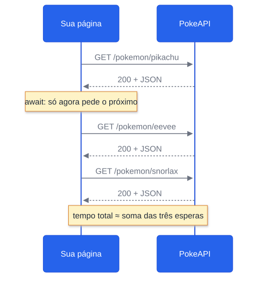
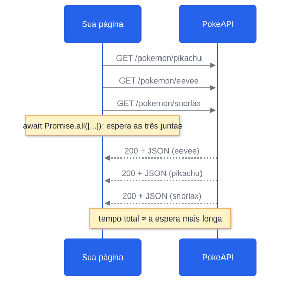

# Aula 12 — Promises por Dentro e Requisições em Paralelo: `Promise.all` e `Promise.allSettled`

[Desenvolvimento Web](../README.md) > Aula 12

**Disciplina:** Desenvolvimento Web
**Duração:** 3h
**Etapa da trilha:** Etapa 4 — Consumo de APIs e Assincronismo (JSON, `fetch`, Promises e `async`/`await`)

**Objetivos de aprendizagem:**

- Explicar o que é uma Promise e identificar seus três estados: pendente, cumprida e rejeitada.
- Criar uma Promise com `new Promise(...)` e consumi-la tanto com `.then`/`.catch` quanto com `async`/`await`.
- Tratar a falha de uma operação assíncrona com `try`/`catch`/`finally`, reconhecendo o erro de esquecer o `await`.
- Comparar o tempo de várias requisições feitas em sequência com o das mesmas requisições feitas em paralelo.
- Escolher entre `Promise.all` e `Promise.allSettled` conforme uma falha deva ou não invalidar o resultado inteiro.

---

## 1. Contextualização

Utilizamos `await fetch(...)` e sabemos que o `fetch` devolve uma **Promise**. Nas últimas aulas você também viu *por que* isso funciona sem travar a página: o JavaScript tem uma única linha de execução, e o navegador cuida da espera enquanto o *event loop* segue atendendo o resto do programa. Faltava abrir a caixa da própria Promise: o que ela é, como se cria uma, e o que o `await` faz com ela.

Isso importa agora por um motivo bem concreto no projeto da Pokédex. A listagem da PokeAPI (`/pokemon?limit=20`) devolve **só o nome e a URL** de cada pokémon, sem imagem nem tipo (ver [`apis.md`](../projeto/apis.md)). Para montar os cards, você precisa de **uma requisição por pokémon**: 20 cards, 20 requisições.

Com o que você sabe até aqui, o caminho natural é um `for` com `await` dentro, que pede um pokémon, espera, pede o próximo, espera... Funciona, mas é lento: cada requisição só começa quando a anterior termina. Hoje você aprende a disparar todas ao mesmo tempo e esperar por elas juntas, com `Promise.all`, e a decidir o que fazer quando uma delas falha, com `Promise.allSettled`.

---

## 2. Conteúdo teórico

### 2.1 Uma Promise é um comprovante de algo que ainda vai chegar

Pense na senha que você recebe ao pedir um lanche: ela ainda não é o lanche, mas garante que você vai ter uma resposta, seja o pedido pronto ou o aviso de que acabou o ingrediente. Uma **Promise** é esse comprovante: um objeto que representa um valor que **ainda não existe**, mas vai existir (ou falhar) no futuro.

Toda Promise está sempre em um destes três estados:

| Estado | Significado | Analogia |
|---|---|---|
| **Pendente** (*pending*) | A operação ainda não terminou | Pedido em preparo |
| **Cumprida** (*fulfilled*) | Terminou com sucesso e tem um **valor** | Lanche entregue |
| **Rejeitada** (*rejected*) | Terminou com falha e tem um **motivo** (um erro) | "Acabou o pão" |

Uma Promise sai de pendente **uma única vez** e, depois disso, nunca mais muda de estado.

Dá para ver isso no console. Sem `await`, o `fetch` devolve o comprovante, não a resposta:

```js
const promessa = fetch("https://pokeapi.co/api/v2/pokemon/pikachu");
console.log(promessa); // Promise {<pending>}
```

### 2.2 Criando uma Promise na mão: `new Promise`

Na maior parte do tempo você **consome** Promises que outras funções criam (como o `fetch`).

```js
function esperar(milissegundos) {
  return new Promise(function (resolve) {
    setTimeout(function () {
      resolve("Esperei " + milissegundos + " ms");
    }, milissegundos);
  });
}
```

O `new Promise(...)` recebe uma função (chamada de *executor*) que o JavaScript executa **na hora**. Ela recebe dois parâmetros, que são funções:

- **`resolve(valor)`** muda a Promise para **cumprida**, com aquele valor.
- **`reject(erro)`** muda a Promise para **rejeitada**, com aquele erro.

Um exemplo que usa os dois: uma tentativa de captura que dá certo ou errado ao acaso.

```js
function tentarCapturar(pokemon) {
  return new Promise(function (resolve, reject) {
    setTimeout(function () {
      if (Math.random() < 0.5) {
        resolve(pokemon + " foi capturado!");
      } else {
        reject(new Error(pokemon + " escapou da Pokébola."));
      }
    }, 1000);
  });
}
```

> [!NOTE]
> O `setTimeout` é quem torna esses exemplos assíncronos: ele entrega a função ao navegador, que só a devolve para a fila do *event loop* depois do tempo pedido. Enquanto isso, a Promise fica **pendente**.

### 2.3 Consumindo uma Promise com `.then` e `.catch`

Antes do `async`/`await` existir, a forma de reagir ao resultado de uma Promise era registrar funções nela:

- **`.then(funcao)`** roda quando a Promise é **cumprida** e recebe o valor.
- **`.catch(funcao)`** roda quando ela é **rejeitada** e recebe o erro.
- **`.finally(funcao)`** roda nos dois casos, sem receber nada. Serve para "limpar" (esconder um *loading*, por exemplo).

```js
tentarCapturar("Eevee")
  .then(function (mensagem) {
    console.log(mensagem);
  })
  .catch(function (erro) {
    console.log("Falhou: " + erro.message);
  })
  .finally(function () {
    console.log("Fim da tentativa.");
  });
```

Cada `.then` devolve **uma nova Promise**, por isso é possível encadear. É assim que se escreve um `fetch` sem `await`:

```js
fetch("https://pokeapi.co/api/v2/pokemon/pikachu")
  .then(function (resposta) {
    return resposta.json(); // devolve outra Promise; o próximo .then espera por ela
  })
  .then(function (pokemon) {
    console.log(pokemon.name + " pesa " + pokemon.weight / 10 + " kg");
  })
  .catch(function (erro) {
    console.log("Erro: " + erro.message);
  });
```

Você vai encontrar muito código escrito assim, em documentações, tutoriais e projetos mais antigos. Reconhecer esse formato é tão importante quanto escrevê-lo.

### 2.4 `async`/`await` é outra forma de escrever a mesma coisa

O mesmo código com `async`/`await`:

```js
async function mostrarPeso() {
  try {
    const resposta = await fetch("https://pokeapi.co/api/v2/pokemon/pikachu");
    const pokemon = await resposta.json();
    console.log(pokemon.name + " pesa " + pokemon.weight / 10 + " kg");
  } catch (erro) {
    console.log("Erro: " + erro.message);
  }
}
```

Por baixo, é **a mesma coisa**. O `await` não substitui a Promise, ele só espera por ela de um jeito que se lê de cima para baixo. A correspondência é direta:

| Com `.then`/`.catch` | Com `async`/`await` |
|---|---|
| `promessa.then(function (valor) { ... })` | `const valor = await promessa;` |
| `.catch(function (erro) { ... })` | `try { ... } catch (erro) { ... }` |
| `.finally(function () { ... })` | `try { ... } finally { ... }` |
| Promise **rejeitada** | O `await` **lança** o erro, como um `throw` |

E o contrário também vale: **toda função `async` devolve uma Promise**, mesmo que você escreva `return 5`. O `return` vira o valor da Promise cumprida; um `throw` lá dentro vira a Promise rejeitada.

```js
async function numeroDaSorte() {
  return 25;
}

console.log(numeroDaSorte()); // Promise {<fulfilled>: 25}, e não 25
```

> [!WARNING]
> O erro mais comum com Promises é **esquecer o `await`**. Sem ele, a variável guarda o comprovante, não o valor:
>
> ```js
> const pokemon = buscarPokemon("pikachu"); // faltou o await
> console.log(pokemon.name);                // undefined: pokemon é uma Promise
> ```
>
> Nenhum erro aparece, só um `undefined` estranho, e por isso ele engana. Se um dado "sumiu" logo depois de uma chamada assíncrona, confira o `await` antes de qualquer outra coisa. Todo mundo que programa em JavaScript já caiu nisso.

### 2.5 Várias requisições, uma de cada vez

Suponha a função abaixo, que busca **um** pokémon e já confere o status (como nas Aulas 10 e 11):

```js
const API = "https://pokeapi.co/api/v2/pokemon/";

async function buscarPokemon(nome) {
  const resposta = await fetch(API + nome);

  if (!resposta.ok) {
    throw new Error("Pokémon \"" + nome + "\" não encontrado (status " + resposta.status + ").");
  }

  const pokemon = await resposta.json();
  return pokemon;
}
```

Para buscar um time inteiro, o caminho mais direto é um `for` com `await`:

```js
const nomes = ["pikachu", "eevee", "snorlax"];
const time = [];

for (let i = 0; i < nomes.length; i++) {
  const pokemon = await buscarPokemon(nomes[i]); // espera ESTE terminar...
  time.push(pokemon);                            // ...antes de pedir o próximo
}
```

Funciona e está correto. Mas repare no que o `await` faz dentro do laço: a requisição do `eevee` **só começa** depois que a do `pikachu` terminou. O tempo total é a **soma** de todas as esperas. Três pokémons não fazem diferença; os 20 da listagem já fazem.

Há situações em que esperar é obrigatório: quando uma requisição **depende** do resultado da anterior (por exemplo, buscar o `Guid` pelo username e só depois buscar os favoritos com esse `Guid`, como na Aula 11). Aqui não é o caso: buscar o `eevee` não precisa de nada que venha do `pikachu`.

### 2.6 Todas ao mesmo tempo: `Promise.all`

A ideia é separar dois momentos: **disparar** todas as requisições primeiro e **esperar** por elas depois.

```js
const nomes = ["pikachu", "eevee", "snorlax"];
const promessas = [];

// Etapa 1: dispara todas, sem await (cada chamada devolve uma Promise pendente)
for (let i = 0; i < nomes.length; i++) {
  promessas.push(buscarPokemon(nomes[i]));
}

// Etapa 2: espera todas juntas
const time = await Promise.all(promessas);
console.log(time[0].name); // "pikachu"
```

**`Promise.all(arrayDePromises)`** devolve **uma única Promise** que:

- **cumpre** quando **todas** cumprirem, com um array de valores **na mesma ordem do array de entrada**, não na ordem em que as respostas chegaram;
- **rejeita** assim que **qualquer uma** rejeitar, com o erro dessa primeira falha. É "tudo ou nada".

Como as requisições correm juntas, o tempo total fica próximo da **espera mais longa**, não da soma de todas.

> [!TIP]
> Se você já usa `map` (funções de alta ordem), o laço da etapa 1 cabe em uma linha: `const promessas = nomes.map(buscarPokemon);`. O resultado é o mesmo: um array de Promises.

> [!IMPORTANT]
> "Ao mesmo tempo" aqui quer dizer **as esperas se sobrepõem**. O JavaScript continua executando uma linha por vez. O que roda em paralelo é o trabalho do navegador e do servidor enquanto as respostas não chegam.

### 2.7 Quando uma falha não pode derrubar todas: `Promise.allSettled`

O "tudo ou nada" do `Promise.all` é o comportamento certo quando o resultado só faz sentido completo, como uma tela que compara dois pokémons lado a lado. Mas numa listagem, se **um** pokémon falhar, não faz sentido deixar os outros 19 de fora.

**`Promise.allSettled(arrayDePromises)`** espera **todas** terminarem, deem certo ou não, e **sempre cumpre**. O valor é um array com um objeto por Promise, na mesma ordem da entrada:

```js
const resultados = await Promise.allSettled([
  buscarPokemon("pikachu"),
  buscarPokemon("pikachuu") // nome digitado errado: 404
]);

console.log(resultados);
// [
//   { status: "fulfilled", value: { name: "pikachu", ... } },
//   { status: "rejected",  reason: Error: Pokémon "pikachuu" não encontrado (status 404). }
// ]
```

| Campo | Quando existe | O que contém |
|---|---|---|
| `status` | Sempre | `"fulfilled"` (cumprida) ou `"rejected"` (rejeitada) |
| `value` | Só se `status` for `"fulfilled"` | O valor da Promise (aqui, o pokémon) |
| `reason` | Só se `status` for `"rejected"` | O erro que a rejeitou |

Para separar o que deu certo do que falhou, percorra o array e olhe o `status` de cada item. É exatamente o que o exemplo da seção 4 faz no "Agora modifique".

> [!NOTE]
> Existem ainda `Promise.race` (a primeira que **terminar**, dando certo ou não) e `Promise.any` (a primeira que **der certo**). São menos usadas no dia a dia e ficam como referência na seção 7.

---

## 3. Diagramas

### 3.1 Os estados de uma Promise



*Código-fonte do diagrama: [`diagramas/01-estados-promise.mmd`](diagramas/01-estados-promise.mmd)*

Uma Promise sai de **pendente** uma única vez, para **cumprida** ou para **rejeitada**, e o `await` (ou o `.then`/`.catch`) reage a esse desfecho.

### 3.2 Três requisições em sequência



*Código-fonte do diagrama: [`diagramas/02-requisicoes-em-sequencia.mmd`](diagramas/02-requisicoes-em-sequencia.mmd)*

Com `await` dentro do `for`, cada pedido espera a resposta do anterior. As esperas **se somam**.

### 3.3 As mesmas três requisições em paralelo



*Código-fonte do diagrama: [`diagramas/03-requisicoes-em-paralelo.mmd`](diagramas/03-requisicoes-em-paralelo.mmd)*

Os três pedidos saem de uma vez e as esperas **se sobrepõem**. As respostas podem chegar em qualquer ordem, mas o array devolvido pelo `Promise.all` segue a ordem em que as Promises foram passadas.

### 3.4 `Promise.all` ou `Promise.allSettled`?



*Código-fonte do diagrama: [`diagramas/04-all-x-allsettled.mmd`](diagramas/04-all-x-allsettled.mmd)*

A escolha não é técnica, é de **regra de negócio**: o resultado parcial serve para alguma coisa ou não?

---

## 4. Exemplo de código

Uma página que monta um time de pokémons a partir de uma lista de nomes, com dois botões: um que busca os pokémons **em sequência** e outro que busca **em paralelo** com `Promise.all`. A página mede e mostra quanto tempo cada botão levou.

Salve os três arquivos abaixo na mesma pasta e abra o `index.html` no navegador.

### Antes de rodar

Leia o `app.js` e tente prever, **antes** de abrir a página:

1. Qual dos dois botões vai terminar mais rápido? Aproximadamente quantas vezes mais rápido, com 6 pokémons?
2. No modo paralelo, as respostas chegam em ordem imprevisível. Os cards vão aparecer na ordem da lista ou na ordem de chegada?
3. Se você trocar `eevee` por `eeve` (com um "e" a menos), o que aparece na tela em cada botão?

### `index.html`

```html
<!DOCTYPE html>
<html lang="pt-br">
<head>
  <meta charset="UTF-8">
  <title>Pokédex — Montar time</title>
  <link rel="stylesheet" href="style.css">
</head>
<body>
  <h1>Pokédex — Montar time</h1>

  <label for="nomes">Nomes separados por vírgula</label>
  <input type="text" id="nomes" value="pikachu, bulbasaur, charmander, squirtle, eevee, snorlax">

  <div class="botoes">
    <button id="btnSequencia">Carregar em sequência</button>
    <button id="btnParalelo">Carregar em paralelo</button>
  </div>

  <p id="saida">Escolha um dos botões.</p>

  <div id="time"></div>

  <script src="app.js"></script>
</body>
</html>
```

### `style.css`

```css
body {
  font-family: Arial, Helvetica, sans-serif;
  max-width: 720px;
  margin: 24px auto;
  padding: 0 16px;
  color: #2c2c2a;
}

input {
  width: 100%;
  box-sizing: border-box;
  padding: 6px 8px;
  margin: 4px 0 12px;
  border: 1px solid #c9c8c2;
  border-radius: 4px;
}

button {
  padding: 6px 14px;
  border: none;
  border-radius: 4px;
  background-color: #2563eb;
  color: #ffffff;
  cursor: pointer;
}

#saida {
  background-color: #ededeb;
  border-left: 4px solid #2563eb;
  padding: 12px 16px;
}

#time {
  display: grid;
  grid-template-columns: repeat(auto-fill, minmax(140px, 1fr));
  gap: 12px;
}

.card {
  border: 1px solid #c9c8c2;
  border-radius: 6px;
  padding: 8px;
  text-align: center;
  text-transform: capitalize;
}
```

### `app.js`

```js
const API = "https://pokeapi.co/api/v2/pokemon/";

const campoNomes = document.getElementById("nomes");
const saida = document.getElementById("saida");
const areaTime = document.getElementById("time");

function mostrar(mensagem) {
  saida.textContent = mensagem;
}

// Etapa 1: ler a lista de nomes digitada pelo usuário
function lerNomes() {
  const partes = campoNomes.value.split(",");
  const nomes = [];

  for (let i = 0; i < partes.length; i++) {
    const nome = partes[i].trim().toLowerCase();
    if (nome !== "") {
      nomes.push(nome);
    }
  }

  return nomes;
}

// Etapa 2: buscar UM pokémon (é async, então devolve uma Promise)
async function buscarPokemon(nome) {
  const resposta = await fetch(API + nome);

  if (!resposta.ok) {
    throw new Error("Pokémon \"" + nome + "\" não encontrado (status " + resposta.status + ").");
  }

  const pokemon = await resposta.json();
  return pokemon;
}

// Etapa 3: desenhar um card para cada pokémon, na ordem do array
function exibirTime(pokemons) {
  areaTime.textContent = "";

  for (let i = 0; i < pokemons.length; i++) {
    const pokemon = pokemons[i];

    const card = document.createElement("div");
    card.className = "card";

    const imagem = document.createElement("img");
    imagem.src = pokemon.sprites.front_default;
    imagem.alt = pokemon.name;

    const nome = document.createElement("h3");
    nome.textContent = "#" + pokemon.id + " " + pokemon.name;

    card.appendChild(imagem);
    card.appendChild(nome);
    areaTime.appendChild(card);
  }
}

// Etapa 4a: em SEQUÊNCIA, cada requisição espera a anterior terminar
async function carregarEmSequencia() {
  const nomes = lerNomes();
  areaTime.textContent = "";
  mostrar("Carregando em sequência...");
  const inicio = performance.now();

  try {
    const pokemons = [];

    for (let i = 0; i < nomes.length; i++) {
      const pokemon = await buscarPokemon(nomes[i]);
      pokemons.push(pokemon);
    }

    exibirTime(pokemons);
    const tempo = Math.round(performance.now() - inicio);
    mostrar(pokemons.length + " pokémons em sequência, em " + tempo + " ms.");
  } catch (erro) {
    mostrar("Erro: " + erro.message);
  }
}

// Etapa 4b: em PARALELO, dispara todas e depois espera todas juntas
async function carregarEmParalelo() {
  const nomes = lerNomes();
  areaTime.textContent = "";
  mostrar("Carregando em paralelo...");
  const inicio = performance.now();

  try {
    const promessas = [];

    for (let i = 0; i < nomes.length; i++) {
      promessas.push(buscarPokemon(nomes[i])); // sem await: só dispara
    }

    const pokemons = await Promise.all(promessas);

    exibirTime(pokemons);
    const tempo = Math.round(performance.now() - inicio);
    mostrar(pokemons.length + " pokémons em paralelo, em " + tempo + " ms.");
  } catch (erro) {
    mostrar("Erro: " + erro.message);
  }
}

document.getElementById("btnSequencia").addEventListener("click", carregarEmSequencia);
document.getElementById("btnParalelo").addEventListener("click", carregarEmParalelo);
```

### Execute e confira

Abra o `index.html` com o **F12 → aba Network** aberto e marque a opção **Disable cache**. Sem isso, o navegador reaproveita as respostas já recebidas e a segunda medição sai falsamente rápida.

| Ação | O que você deve ver |
|---|---|
| Clicar em **Carregar em sequência** | Na aba Network, as 6 requisições em **escada**: cada barra começa quando a anterior termina. A mensagem mostra o tempo total |
| Clicar em **Carregar em paralelo** | As 6 barras começam **praticamente juntas**. O tempo total cai para algo próximo da requisição mais lenta: com 6 pokémons, costuma ficar várias vezes menor |
| Comparar a ordem dos cards | Nos dois botões, os cards aparecem **na ordem da lista digitada**, mesmo no paralelo, em que as respostas chegam fora de ordem |
| Trocar `eevee` por `eeve` e clicar em cada botão | Nos dois casos: `Erro: Pokémon "eeve" não encontrado (status 404).` e **nenhum** card na tela |

Os tempos exatos variam com a sua conexão e com o servidor, então não se preocupe se os seus números forem diferentes dos do colega. O que deve se repetir é a **proporção** entre os dois botões.

Compare com as suas previsões. Se você previu que os cards do paralelo sairiam na ordem de chegada, faz todo o sentido ter pensado assim: é justamente o detalhe que o `Promise.all` resolve por você.

### Entendendo o código linha a linha

**Etapa 1: `lerNomes`**

- `campoNomes.value.split(",")` quebra o texto em um array a cada vírgula.
- `.trim()` remove os espaços das pontas e `.toLowerCase()` deixa tudo minúsculo, porque a PokeAPI só aceita nomes em minúsculas (`Pikachu` dá `404`).
- O `if (nome !== "")` ignora pedaços vazios, como o que sobra de uma vírgula no final.

**Etapa 2: `buscarPokemon`**

- É a mesma estrutura das Aulas 10 e 11: `fetch`, conferir `resposta.ok`, ler com `.json()`.
- Por ser `async`, a função **devolve uma Promise** (seção 2.4). O `return pokemon` vira o valor da Promise cumprida e o `throw` vira a Promise rejeitada. É isso que permite colocar o resultado dela dentro de um `Promise.all`.

**Etapa 3: `exibirTime`**

- Percorre o array **na ordem em que ele está** e cria um card por pokémon com `createElement`/`appendChild`, como na manipulação do DOM das aulas anteriores.
- `pokemon.sprites.front_default` é a URL da imagem e `pokemon.id` é o número na Pokédex (ver [`apis.md`](../projeto/apis.md)).

**Etapa 4a: `carregarEmSequencia`**

- `performance.now()` devolve o tempo atual em milissegundos, com precisão. A diferença entre o valor do fim e o do início é o tempo gasto.
- O `await buscarPokemon(nomes[i])` **dentro do `for`** faz o laço parar a cada volta até aquela requisição terminar. É a escada que você viu na aba Network.

**Etapa 4b: `carregarEmParalelo`**

- O `for` agora chama `buscarPokemon` **sem `await`**. Cada chamada dispara uma requisição e devolve, na hora, uma Promise pendente, que vai para o array `promessas`. O laço termina quase instantaneamente, com as 6 requisições já em andamento.
- `await Promise.all(promessas)` espera todas. Se todas cumprirem, `pokemons` é um array de objetos **na mesma ordem de `promessas`**, e por isso os cards saem na ordem da lista.
- Se **uma** rejeitar, o `Promise.all` rejeita inteiro, o `await` lança o erro e o `catch` mostra a mensagem. Os pokémons que deram certo são descartados.

> [!NOTE]
> Repare que as funções 4a e 4b são quase idênticas. A diferença inteira está em **onde o `await` está**: dentro do laço (uma de cada vez) ou depois dele, no `Promise.all` (todas juntas).

### Agora modifique

1. Na `carregarEmParalelo`, troque `Promise.all` por `Promise.allSettled` e ajuste o código para exibir os pokémons que **deram certo** e listar, na mensagem de saída, os que falharam. Teste com `pikachu, eeve, snorlax`: devem aparecer 2 cards e uma mensagem de erro sobre `eeve`. Dica: percorra `resultados`, colocando em um array o `value` dos itens com `status === "fulfilled"` e em outro o `reason.message` dos itens com `status === "rejected"`.
2. Mostre no card também os **tipos** de cada pokémon (ex.: `electric`, ou `grass / poison`). Eles estão em `pokemon.types[i].type.name`.

### Desafio

Monte a primeira página da listagem do projeto (US01), combinando as duas formas de esperar:

- **primeiro**, uma requisição a `https://pokeapi.co/api/v2/pokemon?limit=12` para obter os nomes. Ela precisa terminar antes, porque as próximas dependem dela;
- **depois**, as 12 requisições de detalhes **em paralelo**, reaproveitando `buscarPokemon` e `exibirTime`.

Você escolhe se usa `Promise.all` ou `Promise.allSettled`. Justifique a escolha em um comentário no código: o que o usuário da sua Pokédex deve ver se um dos 12 pokémons falhar?

---

## 5. Resumo


*Código-fonte do diagrama: [`diagramas/05-resumo-aula-12.mmd`](diagramas/05-resumo-aula-12.mmd)*

- Uma **Promise** representa um valor que ainda vai chegar e está sempre em um de três estados: **pendente**, **cumprida** (com um valor) ou **rejeitada** (com um erro).
- `new Promise(function (resolve, reject) { ... })` cria uma Promise: `resolve` cumpre, `reject` rejeita.
- `.then`/`.catch`/`.finally` e `async`/`await` são duas formas de escrever a mesma coisa. Uma Promise rejeitada faz o `await` **lançar** o erro, que o `try`/`catch` recolhe.
- Toda função `async` devolve uma Promise. Esquecer o `await` deixa na variável a Promise, e não o valor.
- `await` dentro de um `for` faz as requisições **uma de cada vez**, e o tempo total é a soma das esperas. Use isso só quando uma depende da outra.
- Para requisições independentes, **dispare todas primeiro e espere depois**:
  - `Promise.all` cumpre com os valores **na ordem de entrada** e rejeita na primeira falha (tudo ou nada);
  - `Promise.allSettled` espera todas e informa `status` e `value`/`reason` de cada uma, para você aproveitar o que deu certo.

---

## 6. Exercícios

Pratique os conceitos desta aula na lista de exercícios dedicada, com questão de discussão em sala, exercícios de fixação e desafios de criação:

**[`exercicios/exercicios-12.md`](exercicios/exercicios-12.md)**

---

## 7. Referências

**Básica**

- MDN Web Docs. *Usando promises*. Disponível em: https://developer.mozilla.org/pt-BR/docs/Web/JavaScript/Guide/Using_promises
- MDN Web Docs. *async function*. Disponível em: https://developer.mozilla.org/pt-BR/docs/Web/JavaScript/Reference/Statements/async_function
- MDN Web Docs. *Promise.all()*. Disponível em: https://developer.mozilla.org/pt-BR/docs/Web/JavaScript/Reference/Global_Objects/Promise/all

**Complementar**

- MDN Web Docs. *Promise.allSettled()*. Disponível em: https://developer.mozilla.org/pt-BR/docs/Web/JavaScript/Reference/Global_Objects/Promise/allSettled
- MDN Web Docs. *Promise* (inclui `Promise.race` e `Promise.any`). Disponível em: https://developer.mozilla.org/pt-BR/docs/Web/JavaScript/Reference/Global_Objects/Promise
- MDN Web Docs. *Performance: now()*. Disponível em: https://developer.mozilla.org/en-US/docs/Web/API/Performance/now
- PokeAPI. *Documentação v2*. Disponível em: https://pokeapi.co/docs/v2

---

## 8. Próxima aula

Agora você sabe disparar várias requisições e esperar por elas. Ainda faltam duas situações que toda aplicação real enfrenta: uma requisição que **demora demais** e precisa ser cancelada, e uma que **falha por instabilidade** e merece uma nova tentativa. A próxima aula aprofunda Promises com `AbortController` para cancelar requisições e com uma estratégia de *retry*, preparando a Pokédex para funcionar bem mesmo com uma conexão ruim.
